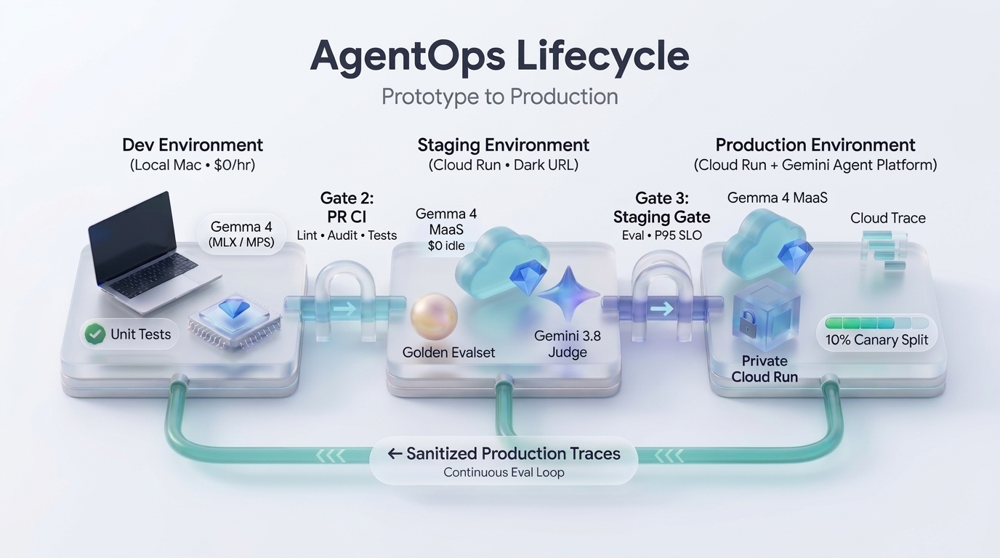
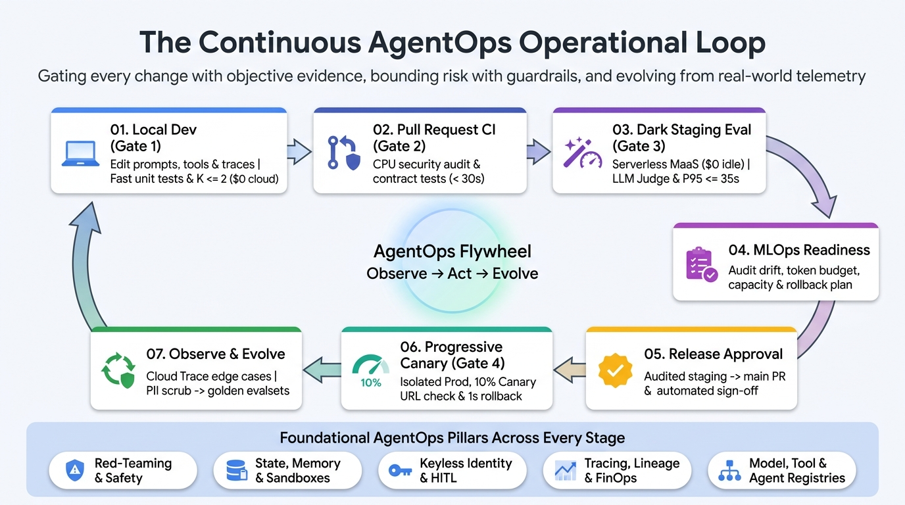

# AgentOps on Google Cloud: ADK & Gemma 4

Google's [*Prototype to Production*](https://www.kaggle.com/whitepaper-prototype-to-production) whitepaper defined the AgentOps blueprint; this repository gives you the actual open-source code, pipelines, and commands to build it.

A practical AgentOps reference implementation for taking an open-weights Google ADK + Gemma 4 agent (a Cloud FinOps & GPU Capacity Advisor in `app/`) from local Apple Silicon prototyping to isolated Google Cloud production via keyless GitHub Actions CI/CD:

1. **Stage 1 - Local Prototyping on Apple Silicon (`dev` | Gate 1 & PR Gate 2)**: Run a warm 4-bit Gemma server locally (`mlx` / `mps`) at `$0` cloud cost, author deterministic FinOps tools, enforce the single-user Work Multiplier (`K <= 2`) via `pytest`, and gate Pull Requests on standard CPU runners (`pip-audit` + unit tests in `< 30s`).
2. **Stage 2 - Pre-Production Validation on Cloud Run (`staging` | Gate 3A & 3B)**: Authenticate via keyless Workload Identity Federation (OIDC) into `staging-project`, deploy zero-traffic dark revisions (`--no-traffic`) backed by Gemini Agent Platform Gemma 4 MaaS (`google/gemma-4-26b-a4b-it-maas`) at `$0` idle GPU cost, evaluate trajectories with Gemini 3.8 Flash as an LLM Judge (`adk eval`), and run a concurrent dark-URL smoke & P95 latency gate before shifting traffic.
3. **Stage 3 - Isolated Production Canary Rollout & Closed-Loop Feedback (`main` | Gate 4)**: Promote to an isolated `prod-project` on Cloud Run + Gemini Agent Platform Gemma 4 MaaS (add Gemini Agent Platform Provisioned Throughput (PT) when guaranteed high-QPS SLAs are needed), validate behind a `10%` Cloud Run Canary split, and verify the full `Observe -> Act -> Evolve` loop when new production traces expose a regression.

> [!NOTE]
> **What you will build:** By the end of this walkthrough, you will have a standalone `adk-gemma-agentops` repository under your own GitHub account, complete with `dev -> staging -> main` promotion branches, keyless Google Cloud IAM/OIDC wiring, and automated GitHub Actions AgentOps pipelines (unit/audit PR checks, Staging `adk eval` with Gemini 3.8 Flash, dark-URL P95 latency checks, and `10%` Production canary rollouts). Because GitHub Actions only runs workflows from a repository's root `.github/workflows/`, you start by copying this folder into your own private repo so you can run every automated gate end to end.

**Companion 3-Part Medium Blog Series:**

- **Part 1**: *AgentOps on Google Cloud (Part 1): Local Prototyping with ADK and Gemma 4*
- **Part 2**: *AgentOps on Google Cloud (Part 2): Staging Eval & Capacity Sizing on Cloud Run*
- **Part 3**: *AgentOps on Google Cloud (Part 3): Production Canary Rollouts with Cloud Run & Gemma 4 MaaS*



---

## The 3-Stage Environment Matrix

| Stage & Branch | Environment | Runtime & Serving Engine | Data Governance Tier | Promotion Gates |
| :--- | :--- | :--- | :--- | :--- |
| Stage 1: Dev (`dev`) | `AGENT_ENV=dev` | Apple Silicon Unified Memory (`mlx` / `mps`) | `synthetic_fixtures_only` | Gate 1 (Local `pytest` + `K <= 2`) -> Gate 2 (PR CI on GitHub CPU: `ruff` + `pip-audit` + `pytest`) |
| Stage 2: Staging (`staging`) | `AGENT_ENV=staging` | Cloud Run (`staging-project`) + Gemini Agent Platform Gemma 4 MaaS (`global`, `$0` idle) | `anonymized_staging_snapshot` | Gate 3A (Gemini 3.8 Flash Judge) + Gate 3B (Dark-URL concurrency & P95 SLO gate) |
| Stage 3: Prod (`main`) | `AGENT_ENV=prod` | Cloud Run (`prod-project`) + Gemini Agent Platform Gemma 4 MaaS (`global`, optional PT) | `live_production_data` | Gate 4 (`10%` Canary traffic split + Canary SLO check -> `100%` cutover) |

---

## Requirements & Initial Setup

### 1. Local Tooling & Authentication

| Requirement | Minimum / Scope | Required Setup / Verification |
| :--- | :--- | :--- |
| Python & `uv` | Python `>= 3.13`, [`uv`](https://docs.astral.sh/uv/) | `uv --version` (`uv` manages Python 3.13 and `.venv` automatically) |
| Google Cloud SDK (`gcloud`) | Installed & authenticated | Run both `gcloud auth login` (CLI/deploy) and `gcloud auth application-default login` (local ADK/SDK) |
| GitHub CLI (`gh`) | Installed & authenticated | Run `gh auth login` (used for PR gates, `gh variable set` in WIF setup, and `gh run watch`) |
| Hugging Face Token | Read token (`HF_TOKEN`) | Accept the Gemma license on Hugging Face and create a [User Access Token](https://huggingface.co/settings/tokens) |
| Local Hardware (Stage 1) | Apple Silicon Mac (`16GB-36GB+` RAM) | Runs local warm 4-bit Gemma serving (`mlx` or `mps` on macOS) at `$0` cloud cost |

### 2. Cloud Projects & GitHub Repository Topology

- **Two Billing-Enabled Google Cloud Projects** (where your account holds `Owner` or `Project IAM Admin` + `Workload Identity Pool Admin` to run [`cicd/setup_wif.py`](./cicd/setup_wif.py)):
  - **`staging-project` (Stage 2)**: Hosts `gemma-agent-staging` on Cloud Run (`us-west1`), serverless Gemini Agent Platform Gemma 4 MaaS (`google/gemma-4-26b-a4b-it-maas` on `global`, pay-per-token, `$0` idle), and Gemini 3.8 Flash evaluation (`global`).
  - **`prod-project` (Stage 3)**: Isolated Production project hosting `gemma-agent-prod` on Cloud Run (`us-west1`) and Gemini Agent Platform Gemma 4 MaaS (`global`) for strict blast-radius, billing, and data-governance isolation. Zero regional GPU quota or GPU provisioning is required for serverless MaaS (for guaranteed high-QPS production throughput, purchase Gemini Agent Platform Provisioned Throughput (PT)).
- **Standalone GitHub Repository with Admin Access & 3 Branches (`dev` -> `staging` -> `main`)**:
  - Because this blueprint lives inside a subfolder of `GoogleCloudPlatform/generative-ai` (`agents/adk-gemma-agentops`) and GitHub Actions only discovers workflows at a repository's root `.github/workflows/`, extract this subfolder into a new standalone GitHub repository under your own GitHub user/org (Admin access lets `cicd/setup_wif.py` register Actions Repository Variables and run workflows).
  - Initialize all three promotion branches on `origin`: `dev` (Stage 1 iteration), `staging` (Stage 2 Gate 3A/3B), and `main` (Stage 3 Gate 4 Canary).

### 3. Bootstrap Standalone Repository, Branches & Local Environment

Because GitHub Actions only discovers pipelines under a repository's root `.github/workflows/`, start by extracting this blueprint into your own standalone repository seeded with only `.gitignore` and `.python-version`. Leaving the agent code as uncommitted local changes on your laptop lets you walk through the full progressive promotion lifecycle (`dev -> staging -> main`) while keeping this `README.md` readable in your IDE across all three stages:

1. **Verify Cloud, ADC & GitHub CLI Authentication**: Confirm that `gcloud` (for Stage 2/3 Google Cloud provisioning), Application Default Credentials (`gcloud auth application-default login`, required by `adk eval` and Gemini Agent Platform MaaS), and `gh` (for PR promotion gates, Actions variables, and workflow monitoring) are all authenticated before creating resources:

   ```bash
   gcloud auth list
   gcloud auth application-default print-access-token >/dev/null && echo "ADC OK"
   gh auth status
   ```

2. **Clone the Sample Blueprint**: Copy the `agents/adk-gemma-agentops` folder from `GoogleCloudPlatform/generative-ai` into a clean standalone working directory:

   ```bash
   git clone --depth 1 https://github.com/GoogleCloudPlatform/generative-ai.git
   mv generative-ai/agents/adk-gemma-agentops ./adk-gemma-agentops
   rm -rf generative-ai
   cd adk-gemma-agentops
   ```

3. **Initialize the Standalone Repository Skeleton (`main`)**: Create your private GitHub repository containing only `.gitignore` and `.python-version` so the Stage 1 agent files remain uncommitted local work until Gate 1 passes:

   ```bash
   git init -b main
   git add .gitignore .python-version
   git commit -m "chore: initialize repository skeleton"
   gh repo create adk-gemma-agentops --private --source=. --remote=origin --push
   ```

4. **Create the 3-Stage Promotion Branches (`staging` and `dev`)**: Seed `staging` from the clean skeleton and check out `dev` as your permanent local working branch (after this step, every promotion to `staging` and `main` flows strictly through Pull Requests rather than direct pushes):

   ```bash
   git checkout -B staging && git push -u origin staging
   git checkout -B dev && git push -u origin dev
   ```

5. **Configure Local `.env` & Install Python Dependencies**: Copy `.env.example` to `.env` (edit `.env` and replace `replace_with_your_huggingface_token` with your Hugging Face read token for gated Gemma weights), then let `uv` provision Python 3.13 and the locked dependency set:

   ```bash
   cp .env.example .env
   uv sync --all-extras
   ```

---

## Quickstart: From Laptop to Cloud in 3 Stages

### Stage 1: Local Development on Apple Silicon (AgentOps Level 0)

To keep the focus on the AgentOps lifecycle rather than typing out Python boilerplate from scratch, assume you have just finished coding the local Gemma model server ([`model_serving/gemma_server.py`](./model_serving/gemma_server.py)), the ADK FinOps agent ([`app/agent.py`](./app/agent.py)), and the test suite ([`tests/`](./tests)) in your working directory. Because Bootstrap only committed `.gitignore` and `.python-version`, all of these files currently sit as uncommitted local changes on your laptop.

Before pushing any agent code to GitHub, run through the Gate 1 local inner loop to validate functionality, tool math, and multi-turn efficiency at `$0` cloud cost:

1. **Start Warm Local Model Serving (Terminal 1)**: Keep 4-bit Gemma weights resident in Apple Unified Memory (`http://127.0.0.1:8080/v1`) so agent edits in `app/agent.py` reload in `< 0.5s` without reloading multi-GB model weights on every run:

   ```bash
   uv run python model_serving/gemma_server.py --engine mlx
   ```

2. **Smoke-Test a Single Agent Turn (Terminal 2)**: Open a second terminal and verify that `GemmaEndpointLlm` connects to your local server, invokes `estimate_gemma_vram`, and returns grounded hardware sizing:

   ```bash
   AGENT_ENV=dev uv run adk run app "How much VRAM does gemma-4-26B-A4B-it in 4bit need?"
   ```

3. **Run Gate 1A - Deterministic Math & Work Multiplier Audit (`< 0.2s`, CPU-Only)**: Verify FinOps tool formulas, dynamic MaaS routing, OpenAI tool-turn conversion, PII trace redaction, and enforce the single-user Work Multiplier budget (`K <= 2` LLM turns per request) before spending cloud tokens:

   ```bash
   uv run pytest -v -s tests/unit/test_agent_unit.py -k "not integration"
   ```

4. **Run Gate 1B - Offline Trajectory & Lexical Evaluation (`adk eval`)**: Replay the golden evaluation dataset against your local Gemma server to verify `1.0` tool-call trajectory accuracy, lexical response alignment (`>= 0.65`), and token/latency profiles with zero cloud API calls:

   ```bash
   AGENT_ENV=dev uv run adk eval app ./tests/eval/evalsets/golden.evalset.json \
     --config_file_path=./tests/eval/eval_config_local.json \
     --print_detailed_results
   ```

5. **Commit & Push Validated Baseline to `dev` Only**: Now that Gate 1A and Gate 1B pass locally, stage and push your prototype to the `dev` branch on GitHub (`staging` and `main` remain empty until automated CI/CD gates certify the code):

   ```bash
   git checkout dev
   git add pyproject.toml uv.lock Dockerfile .dockerignore .env.example assets/ environments/ app/ model_serving/ tests/ cicd/
   git commit -m "feat(stage1): add FinOps advisor tools, local server, and golden evalset (K=2)"
   git push -u origin dev
   ```

See the [Google ADK Evaluation Documentation](https://google.github.io/adk-docs/evaluate/) for custom metrics and multi-turn trajectory authoring.

> [!NOTE]
> **Architecture Callout: Evaluation Metadata and Lineage in AgentOps:** In traditional MLOps, training pipelines record hyperparameters, model artifacts, and scalar loss curves into a centralized registry (such as Gemini Agent Platform Metadata, MLflow, or Weights & Biases).
>
> In AgentOps, metadata tracking is even more vital because agents are non-deterministic, multi-turn compound systems. When you execute `adk eval`, ADK automatically logs the complete execution record into a local file-based metadata store at `app/.adk/eval_history/<run_id>.evalset_result.json`. This captures:
>
> - **Trajectory Lineage**: The exact prompt, tool schemas, tool arguments, and raw tool outputs per turn.
> - **Cost Accounting**: Detailed token breakdowns (prompt, cached, tool use, output) and latency distributions (model vs. tool vs. framework).
> - **Evaluator Verdicts**: Lexical similarity scores and LLM-as-a-Judge semantic rationales.
>
> Scope: To keep this guide focused and friction-free for local development without requiring extra cloud database infrastructure, we skip setting up a full centralized metadata registry and rely on ADK's local evaluation history files. In enterprise staging and production pipelines (Stages 2 and 3), these records and OpenTelemetry Gen AI spans are streamed to a centralized metadata store (such as Gemini Agent Platform ML Metadata, BigQuery, or Arize Phoenix) to track regression trends across pull requests and power the continuous telemetry flywheel.

#### Gate 2: Configure Pre-Merge CI & Open a Pull Request (dev -> staging)

Passing Gate 1 on one developer's laptop is necessary, but in a team workflow an unverified commit could still introduce a broken pricing formula, a vulnerable package, or a `K > 2` prompt loop before burning paid GPU quota in Staging. Gate 2 enforces those deterministic checks automatically on every Pull Request using standard GitHub-hosted CPU runners (`ubuntu-latest`, `< 30s`, `$0` cloud GPU cost, zero cloud credentials needed):

1. **Activate the Gate 2 Workflow Template**: Copy [`cicd/agent-ci-pr.yml`](./cicd/agent-ci-pr.yml) into `.github/workflows/`, where GitHub Actions discovers active repository pipelines:

   ```bash
   mkdir -p .github/workflows
   cp cicd/agent-ci-pr.yml .github/workflows/agent-ci-pr.yml
   ```

2. **Commit & Push the CI Guardrail to `dev`**: Push the workflow to `dev` (also staging the Stage 1 paths in case you skipped Step 5 above), keeping `staging` untouched until the PR check passes:

   ```bash
   git add .github/workflows/agent-ci-pr.yml pyproject.toml uv.lock Dockerfile .dockerignore .env.example assets/ environments/ app/ model_serving/ tests/ cicd/
   git commit -m "ci: add Gate 2 pre-merge GitHub Actions workflow"
   git push origin dev
   ```

3. **Open the Promotion Pull Request (`dev -> staging`)**: Propose promoting your Stage 1 codebase into `staging` via a Pull Request rather than a direct push. Opening the PR automatically triggers Gate 2 (`ruff` format/lint check, `pip-audit` supply-chain vulnerability scan, and `pytest` unit math and `K <= 2` Work Multiplier audit):

   ```bash
   gh pr create --base staging --head dev \
     --title "feat: promote FinOps Advisor to Cloud Run Staging" \
     --body "Passed Gate 1 local unit tests, supply-chain audit, and K=2 Work Multiplier check."
   ```

4. **Stream the Gate 2 Verdict in Real Time**: Watch the `unit-and-contract-tests` job complete on GitHub Actions (`< 30s`):

   ```bash
   gh pr checks --watch
   ```

5. **Promote to `staging` & Sync `dev`**: Once Gate 2 passes, squash-merge the PR on GitHub so `staging` receives its first certified agent commit, then reconcile `origin/staging`'s squash commit into your local `dev` branch (staying on `dev` so you never push directly to `staging`):

   ```bash
   gh pr merge --squash
   git fetch origin staging && git merge origin/staging --no-edit
   ```

> [!NOTE]
> **Understanding the Gate 2 vs. Gate 3 Pipelines:**
>
> - `agent-ci-pr.yml` is Gate 2 (Pre-Merge CI): It runs hermetic `ruff` lint/format checks, `pytest`, `pip-audit`, and Work Multiplier assertions on GitHub-hosted CPU runners without needing cloud credentials (`$0` cloud GPU cost).
> - `agent-cd-staging.yml` is Gate 3 (Staging CD): It automates Cloud Run dark deployments, Gate 3A (Gemini 3.8 Flash Judge eval on new data), and Gate 3B (dark-URL concurrency & P95 latency verification) whenever new evaluation data or code lands on `staging`. It requires Google Cloud Workload Identity Federation (WIF).
> - In Stage 2 below, we walk through these deployment, evaluation, and verification commands interactively using your local `gcloud` credentials to inspect the Dark Launch, Gemini Judge verdict, and end-to-end latency firsthand before automating Gate 3 in GitHub Actions.

### Stage 2: Staging Evaluation & Dark-Launch Verification on Cloud Run (AgentOps Level 1)

Now that Gate 2 certified our Stage 1 prototype on CPU and merged it into `staging`, we move from local 4-bit Apple Silicon weights to serverless pre-production serving on Google Cloud (`staging-project`).

In AgentOps Level 1, the agent code (`app/agent.py`) stays completely untouched (`AGENT_ENV=staging` switches routing solely via environment configuration to Gemini Agent Platform Gemma 4 MaaS `google/gemma-4-26b-a4b-it-maas` on the `global` endpoint, with zero GPU provisioning and `$0` idle billing) while automation centers on validating new evaluation data or model configurations:

- **Trigger**: Sanitized production edge-case traces arrive in `golden.evalset.json` (such as `production_telemetry_burst_scaling`), or a new Gemma model ID / serving config is staged.
- **Validation Gates**: Gate 3A (`adk eval` scored by Gemini 3.8 Flash as an independent semantic and safety Judge) + Gate 3B (5-user concurrent dark-URL smoke & `P95 <= 35s` latency check; heavy burst testing is unnecessary on shared PayGo MaaS since guaranteed production capacity is handled via Gemini Agent Platform Provisioned Throughput).
- **Runtime & Hosting**: Private Cloud Run revision (`--tag staging-dark`) + serverless Gemini Agent Platform Gemma 4 MaaS (`google/gemma-4-26b-a4b-it-maas`) (`global`, pay-per-token with implicit 90% context caching).

First, walk through each Stage 2 cloud building block interactively from your terminal (next, we automate this exact flow in GitHub Actions):

1. **Bootstrap Staging Google Cloud APIs, Service Agents & Runtime IAM**: Configure your target Staging project and region, then run [`cicd/setup_wif.py`](./cicd/setup_wif.py) to enable Gemini Agent Platform, Cloud Run, Cloud Build, and Artifact Registry and bind least-privilege Cloud Run runtime roles (built-in propagation retries handle brand-new Google Cloud projects in one pass):

   ```bash
   export GOOGLE_CLOUD_PROJECT="staging-project"
   export GCP_REGION="us-west1"

   uv run python cicd/setup_wif.py --env staging --project "$GOOGLE_CLOUD_PROJECT" --region "$GCP_REGION"
   ```

2. **Deploy a Tagged Dark Revision of the ADK Agent to Cloud Run (`staging-dark`)**: Containerize `app/` from source and deploy `gemma-agent-staging` pinned to `1` Cloud Run instance backed by Gemini Agent Platform Gemma 4 MaaS (`USE_MAAS=1`) with `--tag staging-dark` and `--no-allow-unauthenticated`. Cloud Run creates an isolated tag URL (`https://staging-dark---gemma-agent-staging-...run.app`) accessible only to IAM-authenticated callers with OIDC Bearer tokens (no 20-minute GPU deployment required):

   ```bash
   gcloud run deploy gemma-agent-staging \
     --source . \
     --clear-base-image \
     --region "$GCP_REGION" \
     --project "$GOOGLE_CLOUD_PROJECT" \
     --tag staging-dark \
     --no-allow-unauthenticated \
     --session-affinity \
     --timeout=300s \
     --min-instances=1 \
     --max-instances=1 \
     --set-env-vars "AGENT_ENV=staging,USE_MAAS=1,GEMMA_MAAS_MODEL_ID=google/gemma-4-26b-a4b-it-maas,GOOGLE_CLOUD_PROJECT=$GOOGLE_CLOUD_PROJECT,GOOGLE_CLOUD_LOCATION=global,GCP_REGION=$GCP_REGION"
   ```

3. **Run Gate 3A - Semantic & Safety Evaluation with Gemini 3.8 Flash Judge**: With `app/agent.py` completely unchanged, evaluate Gemma 4 26B-A4B MaaS against the golden dataset (including sanitized production edge cases such as `production_telemetry_burst_scaling` in [`tests/eval/evalsets/golden.evalset.json`](./tests/eval/evalsets/golden.evalset.json)) using Gemini 3.8 Flash AutoRaters (`final_response_match_v2`, `hallucinations_v1`, `rubric_based_tool_use_quality_v1`, and `rubric_based_final_response_quality_v1` safety rubric):

   ```bash
   AGENT_ENV=staging USE_MAAS=1 GOOGLE_GENAI_USE_VERTEXAI=1 \
   GOOGLE_CLOUD_PROJECT="$GOOGLE_CLOUD_PROJECT" GOOGLE_CLOUD_LOCATION="global" \
   GCP_REGION="$GCP_REGION" \
   uv run adk eval app ./tests/eval/evalsets/golden.evalset.json \
     --config_file_path=./tests/eval/eval_config.json \
     --print_detailed_results
   ```

4. **Run Gate 3B - Concurrent Dark-URL Smoke & Latency Verification**: Resolve the dedicated `staging-dark` tag URL and execute a 5-user concurrent multi-turn (`K = 2`) check to verify private IAM authentication, ADK session creation, live tool execution against Gemini Agent Platform MaaS, and `P95 <= 35s` latency:

   ```bash
   DARK_URL=$(gcloud run services describe gemma-agent-staging \
     --region "$GCP_REGION" \
     --project "$GOOGLE_CLOUD_PROJECT" \
     --format="value(status.traffic.filter(tag=staging-dark).extract(url).flatten())")

   uv run python tests/load/load_test_cloud_run.py \
     --url "$DARK_URL" \
     --bearer-token "$(gcloud auth print-identity-token)" \
     --users 5 --concurrency 5 --ramp-seconds 2
   ```

5. **Promote the Validated Revision to `100%` Staging Traffic**: Once both Gate 3A (semantic/safety quality) and Gate 3B (end-to-end dark-URL latency SLO) pass, shift `100%` of Staging traffic to the certified `staging-dark` revision with zero downtime:

   ```bash
   gcloud run services update-traffic gemma-agent-staging \
     --region "$GCP_REGION" \
     --project "$GOOGLE_CLOUD_PROJECT" \
     --to-tags staging-dark=100
   ```

#### Automating Stage 2 in GitHub Actions: `cicd/agent-cd-staging.yml`

In Steps 1 through 5 above, you ran the Staging deployment, Gemini Judge evaluation, and dark-URL concurrency check interactively from your laptop to inspect each signal firsthand. Now promote that exact workflow into an automated Gate 3 GitHub Actions pipeline so every merge into `staging` touching evaluation data (`tests/eval/**`), model serving specs (`model_serving/**`), or agent code (`app/**`) automatically:

- Deploys a dark container tagged with the commit SHA (`--tag sha-${GITHUB_SHA::7}` with `--no-traffic`) backed by serverless Gemini Agent Platform Gemma 4 MaaS (`global`, `$0` idle cost).
- Runs Gate 3A (`adk eval app ./tests/eval/evalsets/golden.evalset.json`) scored by Gemini 3.8 Flash as an independent semantic and safety Judge.
- Runs Gate 3B (`load_test_cloud_run.py`) against the isolated dark URL.
- Promotes the dark revision to `100%` Staging traffic with zero downtime only if both gates pass.

> [!NOTE]
> **Enterprise Production Standard (Keyless Cross-Platform Authentication):** Workload Identity Federation (OIDC) is the global industry standard for production environments and authentication across platforms (between GitHub Actions and Google Cloud, AWS, or Azure). It eliminates the need to create or store long-lived service account JSON keys (a leading vector for cloud security breaches) by exchanging short-lived cryptographic tokens scoped to the exact repository and branch. If you do not have IAM administrator permissions to configure WIF in your Google Cloud project, you can continue executing the Stage 2 commands manually from your terminal using your personal `gcloud auth` credentials.

Activate keyless OIDC authentication and watch your first automated Gate 3 Staging promotion end to end:

1. **Configure Keyless WIF & GitHub Actions Variables (`staging`)**: Run [`cicd/setup_wif.py`](./cicd/setup_wif.py) with `--repo` to bind GitHub OIDC Workload Identity Federation, assign least-privilege Staging CD IAM roles, and publish `GCP_PROJECT_ID`, `GCP_REGION`, `WIF_PROVIDER_STAGING`, and `WIF_SA_STAGING` to your repository variables (see [`cicd/README.md`](./cicd/README.md) for the full IAM role matrix and manual `gcloud` commands):

   ```bash
   export GOOGLE_CLOUD_PROJECT="${GOOGLE_CLOUD_PROJECT:-staging-project}"
   export GCP_REGION="${GCP_REGION:-us-west1}"
   export GITHUB_REPO=$(gh repo view --json nameWithOwner -q .nameWithOwner)

   uv run python cicd/setup_wif.py --env staging --project "$GOOGLE_CLOUD_PROJECT" --region "$GCP_REGION" --repo "$GITHUB_REPO"
   ```

2. **Activate & Push the Gate 3 Workflow Template on `dev`**: Sync `dev` with `origin/staging`, copy [`cicd/agent-cd-staging.yml`](./cicd/agent-cd-staging.yml) into `.github/workflows/`, and push the workflow commit to `dev`:

   ```bash
   git checkout dev && git fetch origin staging && git merge origin/staging --no-edit
   cp cicd/agent-cd-staging.yml .github/workflows/agent-cd-staging.yml
   git add .github/workflows/agent-cd-staging.yml
   git commit -m "ci: activate automated Gate 3 Staging CD workflow"
   git push origin dev
   ```

3. **Open the Staging CD Activation PR (`dev -> staging`)**: Propose activating the automated Gate 3 workflow via Pull Request so Gate 2 (`agent-ci-pr.yml`) runs first on CPU:

   ```bash
   gh pr create --base staging --head dev \
     --title "ci: activate automated Gate 3 Staging CD workflow" \
     --body "Enables automated Cloud Run dark deployment, Gemini eval, and dark-URL latency gate on staging."
   ```

4. **Pass Gate 2 & Merge to Trigger Automated Gate 3**: Wait for Gate 2 to go green, squash-merge into `staging` (which automatically triggers `agent-cd-staging.yml` via `on: push`), and reconcile `origin/staging` into your local `dev` branch:

   ```bash
   gh pr checks --watch && gh pr merge --squash
   git fetch origin staging && git merge origin/staging --no-edit
   ```

5. **Monitor the Automated Gate 3 Run on `staging`**: Because your local checkout remains on `dev`, pass `--branch staging` so `gh` resolves the exact workflow run ID and streams live logs (if any step fails, inspect only the failure with `gh run view "$RUN_ID" --log-failed`):

   ```bash
   sleep 5
   gh run list --branch staging --limit 5
   RUN_ID=$(gh run list --branch staging --limit 1 --json databaseId -q '.[0].databaseId')
   gh run watch "$RUN_ID"
   ```

   > [!NOTE]
   > Manual `gh workflow run agent-cd-staging.yml --ref staging` triggers via `workflow_dispatch` only work once the workflow file has also been merged to your repository's default branch (`main`); merges into `staging` automatically trigger via `on: push`.

6. **Verify Zero-Downtime Traffic Cutover on Cloud Run**: Confirm that Gate 3 automatically shifted `100%` of live Staging traffic to the newly certified `sha-*` revision:

   ```bash
   gcloud run services describe gemma-agent-staging \
     --region "$GCP_REGION" \
     --project "$GOOGLE_CLOUD_PROJECT" \
     --flatten="status.traffic[]" \
     --format="table(status.traffic.revisionName:label=REVISION,status.traffic.percent:label=TRAFFIC_PCT,status.traffic.tag:label=TAG,status.traffic.url:label=URL)"
   ```

7. **Smoke-Test the Live Promoted Staging Service**: Resolve the canonical live Staging URL and execute a 1-user IAM-authenticated ADK session + `/run` check end to end:

   ```bash
   STAGING_LIVE_URL=$(gcloud run services describe gemma-agent-staging \
     --region "$GCP_REGION" \
     --project "$GOOGLE_CLOUD_PROJECT" \
     --format="value(status.url)")

   uv run python tests/load/load_test_cloud_run.py \
     --url "$STAGING_LIVE_URL" \
     --bearer-token "$(gcloud auth print-identity-token)" \
     --users 1 --concurrency 1 --ramp-seconds 0
   ```

> [!NOTE]
> **AgentOps Level 1 Data Trigger:** Once Stage 3 is set up below, [Closed-Loop Test Case 1](#test-case-1-gate-3a-blocks-an-unhandled-production-edge-case-staging) exercises the full data-only trigger by injecting a new sanitized trace into `tests/eval/evalsets/golden.evalset.json` with zero changes to `app/agent.py` and verifying that Gate 3A runs automatically on `staging`.

### Stage 3: Production Project Isolation, Readiness & Canary Rollout (AgentOps Level 2)

Now that Stage 2 certified both semantic quality (Gate 3A) and end-to-end dark-URL latency (Gate 3B) in Staging, AgentOps Level 2 shifts to Production isolation, pre-release governance, and progressive Canary delivery.

For enterprise blast-radius, billing, and data-governance isolation (`live_production_data`), Production runs in a dedicated Google Cloud project (`PROD_PROJECT_ID`, such as `prod-project`) separate from Staging (`staging-project`). Cloud Run Production routes to serverless Gemini Agent Platform Gemma 4 MaaS (`google/gemma-4-26b-a4b-it-maas`) on the `global` endpoint (`$0` idle GPU cost; scale to guaranteed high-QPS SLAs with Gemini Agent Platform Provisioned Throughput (PT)). Every release to `main` is guarded by Gate 4 (`agent-cd-prod.yml`), which deploys a dark candidate revision with `--session-affinity`, shifts a `10%` Canary split when a prior revision exists, validates concurrent multi-turn health against the tagged Canary URL within the `35s` P95 SLO, and cuts over to `100%` only if the Canary passes:

1. **Exercise Capacity Sizing on Your Live Staging Agent**: Query your promoted Cloud Run Staging service (`gemma-agent-staging`) to run the FinOps `size_endpoint_capacity` tool (sizing GPU replicas and Cloud Run bounds for 150 concurrent users given a `4.5 RPCs/sec/GPU` benchmark; no local Mac model server needed; expected reply: `3-5 GPU replicas and 3 Cloud Run instances are recommended.`):

   ```bash
   STAGING_LIVE_URL=$(gcloud run services describe gemma-agent-staging \
     --region "$GCP_REGION" \
     --project "$GOOGLE_CLOUD_PROJECT" \
     --format="value(status.url)")

   uv run python tests/load/load_test_cloud_run.py \
     --url "$STAGING_LIVE_URL" \
     --bearer-token "$(gcloud auth print-identity-token)" \
     --users 1 --concurrency 1 --ramp-seconds 0 \
     --prompt "Our Stage 2 benchmark measured 4.5 RPCs/sec per GPU replica. How many GPU replicas and Cloud Run instances do we need for 150 concurrent users with 2 turns per request and a 30 second P95 target?"
   ```

2. **Bootstrap the Isolated Production Google Cloud Project & Keyless WIF**: Enable Production APIs, create Artifact Registry, bind least-privilege runtime and CD IAM roles, configure OIDC Workload Identity Federation, and publish `GCP_PROD_PROJECT_ID`, `WIF_PROVIDER_PROD`, and `WIF_SA_PROD` to GitHub Repository Variables (see [`cicd/README.md`](./cicd/README.md) for manual `gcloud` commands):

   ```bash
   export PROD_PROJECT_ID="${PROD_PROJECT_ID:-prod-project}"
   export GCP_REGION="${GCP_REGION:-us-west1}"
   export GITHUB_REPO=$(gh repo view --json nameWithOwner -q .nameWithOwner)

   uv run python cicd/setup_wif.py --env prod --project "$PROD_PROJECT_ID" --region "$GCP_REGION" --repo "$GITHUB_REPO"
   ```

3. **Activate & Push the Gate 4 Production Workflow on `dev`**: Sync `dev` with `origin/staging`, copy [`cicd/agent-cd-prod.yml`](./cicd/agent-cd-prod.yml) into `.github/workflows/`, and push to `dev`:

   ```bash
   git checkout dev && git fetch origin staging && git merge origin/staging --no-edit
   mkdir -p .github/workflows
   cp cicd/agent-cd-prod.yml .github/workflows/agent-cd-prod.yml
   git add .github/workflows/agent-cd-prod.yml
   git commit -m "ci: activate Gate 4 Production Canary workflow"
   git push origin dev
   ```

4. **Open the Workflow Activation PR (`dev -> staging`)**: Submit the Production workflow through the standard Pull Request path so Gate 2 (`agent-ci-pr.yml`) validates it on CPU first:

   ```bash
   gh pr create --base staging --head dev \
     --title "ci: activate Gate 4 Production Canary workflow" \
     --body "Adds automated Cloud Run production Canary deployment and SLO gate."
   ```

5. **Pass Gate 2 & Merge the Production Workflow into `staging`**: Wait for Gate 2 to pass, squash-merge into `staging`, and sync `dev` (note that `agent-cd-staging.yml` path-filters to Staging code/eval paths, so adding the Production workflow skips redundant Staging runs):

   ```bash
   gh pr checks --watch && gh pr merge --squash
   git fetch origin staging && git merge origin/staging --no-edit
   ```

6. **Run the Pre-Release MLOps Readiness Check (`staging` -> `prod` Governance)**: Before opening the `staging -> main` Release PR, step back from binary pass/fail gates and validate production readiness across four MLOps checks:

   - **Evaluation & token drift**: Inspect the latest Gate 3A run on `staging` (`gh run view`) to verify quality scores did not drift down toward thresholds and `token_usage_v1` / latency did not bloat.
   - **Throughput & quota headroom**: Confirm Gate 3B's dark-URL latency stays well inside your `35s` P95 SLO, verify your Production capacity plan (such as a Gemini Agent Platform Provisioned Throughput (PT) reservation if you require guaranteed QPS), and glance at Staging Cloud Trace for hidden retries or PII hygiene.
   - **Environment & IAM parity**: Confirm any new variables in `environments/staging.env.example` (or your override `environments/staging.env`) and IAM roles (`roles/aiplatform.user`) are mirrored in `environments/prod.env.example` (`prod-project`).
   - **Rollback readiness**: Record the currently serving `gemma-agent-prod` revision so you have a 1-second rollback command ready (`gcloud run services update-traffic gemma-agent-prod --to-revisions="<PREV_REV>=100"`) if Gate 4's `10%` Canary alerts fire:

   ```bash
   STAGING_RUN_ID=$(gh run list --branch staging --limit 1 --json databaseId -q '.[0].databaseId')
   gh run view "$STAGING_RUN_ID"

   gcloud run services describe gemma-agent-prod \
     --region "$GCP_REGION" \
     --project "$PROD_PROJECT_ID" \
     --flatten="status.traffic[]" \
     --format="table(status.traffic.revisionName:label=REVISION,status.traffic.percent:label=TRAFFIC_PCT,status.traffic.tag:label=TAG)" \
     2>/dev/null || echo "Initial production bootstrap (no prior revision yet)"
   ```

7. **Open the Production Release PR (`staging -> main`)**: Propose promoting the Staging-certified commit into `main`, recording the audited Gate 3A scores and Gate 3B P95 latency in the PR body for reviewer sign-off so Gate 2 verifies the Release PR before any Production deployment executes:

   ```bash
   gh pr create --base main --head staging \
     --title "release(v1.0.0): promote validated Staging revision to Production" \
     --body "Passed Gate 3A (Gemini 3.8 Flash Judge) and Gate 3B (Dark-URL Concurrency & P95 SLO Gate)."
   ```

8. **Pass Gate 2 & Merge the Release into `main`**: Pass `staging` explicitly to `gh pr checks` and `gh pr merge` (since your local checkout remains on `dev`), preserving the clean release commit on `main` to trigger Gate 4:

   ```bash
   gh pr checks staging --watch && gh pr merge staging --merge
   ```

9. **Watch Gate 4 Deploy, Run Canary Validation & Cut Over to `100%`**: Stream the `main` branch workflow as Gate 4 deploys `gemma-agent-prod`, shifts a `10%` Canary split when a prior revision exists, validates concurrent multi-turn Canary health within the `35s` P95 SLO, and promotes to `100%` Production traffic:

   ```bash
   sleep 5
   RUN_ID=$(gh run list --branch main --limit 1 --json databaseId -q '.[0].databaseId')
   gh run watch "$RUN_ID"
   ```

> [!NOTE]
> **Scaling Beyond Pay-As-You-Go MaaS:** Stage 2 and Stage 3 run on serverless Gemini Agent Platform Gemma 4 MaaS PayGo (`google/gemma-4-26b-a4b-it-maas`, `$0` idle cost). For high-QPS workloads requiring predictable latency SLAs, reserve Gemini Agent Platform Provisioned Throughput (PT) in `prod-project` and optionally set the `TARGET_PEAK_USERS` GitHub repository variable to increase Gate 4's Canary concurrency check without modifying any code.

---

### Final Closed-Loop Verification (`Observe -> Act -> Evolve`)



With all three environments (`dev`, `staging`, and `prod`) and all four gates active, execute these 3 Closed-Loop Test Cases (using the helper scripts in [`tests/scenarios/`](./tests/scenarios)) to verify the full AgentOps flywheel end to end: new sanitized production data exposes a real pricing bug, Gate 3A blocks bad behavior before traffic shifts, and an engineered fix flows safely from laptop to `100%` Production.

#### Test Case 1: Gate 3A Blocks an Unhandled Production Edge Case (`staging`)

Suppose production telemetry surfaces a query pricing `nvidia-h200-141gb` GPUs (`$14.10/hr`, so `2` replicas at `10` hours/day = `$8,460.00/month`). Because `nvidia-h200-141gb` is not yet in `hourly_rates` inside `app/agent.py`, the current agent silently falls back to `$1.15/hr` (L4) and returns `$690.00`. Verify that injecting this sanitized trace into `golden.evalset.json` (with zero changes to `app/agent.py`) automatically triggers Gate 3A and blocks traffic promotion:

1. **Inject & Push the Sanitized H200 Production Trace on `dev`**: Sync `dev` with `origin/staging`, run [`tests/scenarios/inject_h200_eval_case.py`](./tests/scenarios/inject_h200_eval_case.py) to append the anonymized trace to `golden.evalset.json`, and push the data-only commit to `dev`:

   ```bash
   git checkout dev && git fetch origin staging && git merge origin/staging --no-edit
   uv run python tests/scenarios/inject_h200_eval_case.py
   git add tests/eval/evalsets/golden.evalset.json
   git commit -m "data(eval): add sanitized H200 production trace to golden evalset"
   git push origin dev
   ```

2. **Open the Data-Only Promotion PR (`dev -> staging`)**: Propose adding the new golden evaluation case to `staging` with `app/agent.py` completely unchanged:

   ```bash
   gh pr create --base staging --head dev \
     --title "data(eval): add sanitized H200 production trace" \
     --body "Adds H200 cost trace to golden evalset with app/agent.py unchanged."
   ```

3. **Pass Gate 2 & Merge the New Trace into `staging`**: Wait for Gate 2 (`agent-ci-pr.yml`) to pass on CPU (existing deterministic unit tests and `K <= 2` still hold), squash-merge into `staging` to trigger the `tests/eval/**` Staging pipeline, and sync `dev`:

   ```bash
   gh pr checks --watch && gh pr merge --squash
   git fetch origin staging && git merge origin/staging --no-edit
   ```

4. **Watch Gate 3A Catch the Regression & Block Traffic Promotion**: Stream the automated Staging run on `--branch staging` and verify that Gemini 3.8 Flash Judge flags `$690 != $8,460` and halts promotion:

   ```bash
   sleep 5
   RUN_ID=$(gh run list --branch staging --limit 1 --json databaseId -q '.[0].databaseId')
   gh run watch "$RUN_ID"
   ```

- **Expected Verdict**: Gate 2 passes on the PR (since `K <= 2` and existing unit tests still pass), then `agent-cd-staging.yml` deploys the dark revision (`--no-traffic`), Gate 3A (`Gemini 3.8 Flash Judge`) catches `$690 != $8,460` and exits with code `1`, Gate 3B is skipped, and live Staging and Production remain untouched.

#### Test Case 2: Local TDD Fix & Staging Certification (`dev -> staging` | Gates 1, 2 & 3)

Now complete the Evolve loop using local test-driven development at `$0` cloud GPU cost before sending the fix back through the automated Staging gates:

1. **Apply the Pricing Fix & Verify Gate 1 Locally (`< 0.2s`, CPU-Only)**: Run [`tests/scenarios/apply_h200_pricing_fix.py`](./tests/scenarios/apply_h200_pricing_fix.py) to add `"nvidia-h200-141gb": 14.10` to `app/agent.py` and `test_calculate_serving_cost_h200` to `tests/unit/test_agent_unit.py`, then verify all 12 deterministic unit tests and `K <= 2` locally:

   ```bash
   uv run python tests/scenarios/apply_h200_pricing_fix.py
   PYTHONPATH=. uv run pytest tests/unit/test_agent_unit.py -k "not integration" -v
   ```

2. **Commit & Push the Verified Fix to `dev`**: Stage the pricing fix and unit regression test on `dev` (single quotes preserve the literal `$14.10/hr` in bash):

   ```bash
   git add app/agent.py tests/unit/test_agent_unit.py
   git commit -m 'fix(finops): add nvidia-h200-141gb hourly rate ($14.10/hr) and regression test'
   git push origin dev
   ```

3. **Open the Fix PR (`dev -> staging`)**: Submit the fix through the standard PR promotion path so Gate 2 verifies `pip-audit`, `ruff`, and all 12 unit tests on CPU:

   ```bash
   gh pr create --base staging --head dev \
     --title "fix(finops): support H200 pricing uncovered by Gate 3A eval failure" \
     --body "Fixes silent L4 fallback when pricing nvidia-h200-141gb."
   ```

4. **Pass Gate 2 & Merge the Fix into `staging`**: Wait for Gate 2 to go green, squash-merge into `staging` to re-run Gate 3, and sync `dev`:

   ```bash
   gh pr checks --watch && gh pr merge --squash
   git fetch origin staging && git merge origin/staging --no-edit
   ```

5. **Watch Gate 3A & 3B Certify & Promote the Fix in Staging**: Stream the automated `staging` pipeline as Gemini 3.8 Flash passes all 5 golden cases, Gate 3B clears the dark-URL concurrency & P95 latency gate, and Cloud Run shifts `100%` Staging traffic:

   ```bash
   sleep 5
   RUN_ID=$(gh run list --branch staging --limit 1 --json databaseId -q '.[0].databaseId')
   gh run watch "$RUN_ID"
   ```

- **Expected Verdict**: Gate 1 (`12 passed`), Gate 2 (`pip-audit` + `ruff` + CPU `pytest`), Gate 3A (all 5 golden cases pass), and Gate 3B (dark-URL concurrency & P95 SLO gate) all pass and shift `100%` Staging traffic to the validated revision.

#### Test Case 3: Production Canary Rollout (`staging -> main` | Gate 4)

With Staging green across all 5 golden cases and the P95 latency SLO, promote the certified revision to `main` so Gate 4 executes a progressive `10%` Production Canary before full cutover:

1. **Open the Production Release PR (`staging -> main`)**: Create the Release PR proposing `v1.0.1` from `staging` into `main`:

   ```bash
   gh pr create --base main --head staging \
     --title "release(v1.0.1): promote H200 pricing fix validated by Gate 3A & 3B" \
     --body "Passed Gemini 3.8 Flash Judge on 5-case golden evalset and dark-URL P95 SLO gate."
   ```

2. **Pass Gate 2 & Merge the Fix into `main`**: Pass `staging` explicitly to `gh pr checks` and `gh pr merge` (since your local checkout remains on `dev`) to trigger Gate 4 on `main`:

   ```bash
   gh pr checks staging --watch && gh pr merge staging --merge
   ```

3. **Watch Gate 4 Validate the `10%` Canary & Cut Over to `100%`**: Stream the `main` workflow run as Cloud Run Production shifts a `10%` Canary split, validates concurrent multi-turn Canary health within the `35s` P95 SLO, and cuts over to `100%` live traffic:

   ```bash
   sleep 5
   RUN_ID=$(gh run list --branch main --limit 1 --json databaseId -q '.[0].databaseId')
   gh run watch "$RUN_ID"
   ```

- **Expected Verdict**: Gate 4 deploys the dark candidate revision in `prod-project`, shifts `10%` Canary traffic, validates concurrent multi-turn Canary health within the `35s` P95 SLO, and promotes the fix to `100%` Production traffic.

#### Final Release Step: Publish the Application `README.md` to GitHub

Once all 3 stages and closed-loop test cases are verified, replace this walkthrough tutorial with the standalone application [`README.production.md`](./README.production.md) on GitHub while preserving the tutorial locally in `WALKTHROUGH.md` (already listed in `.gitignore`). Because `README.md` sits outside the code and workflow `paths:` filters in `agent-ci-pr.yml`, `agent-cd-staging.yml`, and `agent-cd-prod.yml`, this docs-only promotion skips unnecessary CI and GPU runs:

1. **Save & Open `WALKTHROUGH.md` in Your IDE First**: Copy this tutorial to gitignored `WALKTHROUGH.md` and switch your IDE tab to `WALKTHROUGH.md` now so Steps 2 through 4 remain visible once `README.md` is replaced:

   ```bash
   cp README.md WALKTHROUGH.md
   ```

2. **Replace `README.md` with `README.production.md` & Push on `dev`**: Sync `dev` with `origin/staging`, promote `README.production.md` to `README.md`, and push to `dev`:

   ```bash
   git checkout dev && git fetch origin staging && git merge origin/staging --no-edit
   mv README.production.md README.md
   git add README.md
   git commit -m "docs(release): publish standalone application README"
   git push origin dev
   ```

3. **Promote the Application README to `staging` (`dev -> staging`)**: Open and squash-merge the docs-only PR into `staging`, then sync `dev`:

   ```bash
   gh pr create --base staging --head dev \
     --title "docs(release): publish application README" \
     --body "Promotes production README."
   gh pr merge --squash
   git fetch origin staging && git merge origin/staging --no-edit
   ```

4. **Promote the Application README to `main` (`staging -> main`)**: Open and merge the docs-only PR into `main` (passing `staging` explicitly to `gh pr merge` since your local checkout remains on `dev`):

   ```bash
   gh pr create --base main --head staging \
     --title "docs(release): publish application README on main" \
     --body "Promotes production README to main."
   gh pr merge staging --merge
   ```

---

## The 4-Gate AgentOps Promotion Pyramid

```text
                ▲
               / \       Gate 4: Production Canary Gate
              /   \      10% Canary traffic shift + SLO validation -> 100%
             /─────\
            /       \     Gate 3: Staging Pre-Production Gate
           /         \    3A: Gemini 3.8 Flash Judge (trajectory = 1.0, response >= 0.85)
          /           \   3B: Dark-URL concurrency & P95 SLO gate
         /─────────────\
        /               \  Gate 2: Pull Request CI Gate
       /                 \ ruff + pytest + pip-audit (< 30s)
      /───────────────────\
     /                     \ Gate 1: Local Pre-Commit Gate
    /                       \ pytest (< 0.2s) + Work Multiplier audit (K <= 2)
   └─────────────────────────┘
```

| Gate | Environment | Trigger | Automated Validation Criteria |
| :--- | :--- | :--- | :--- |
| Gate 1 | Local Mac | Developer edit | Deterministic `pytest` unit math + `K <= 2` Work Multiplier check. |
| Gate 2 | GitHub Actions CPU (`ubuntu-latest`) | PR (`dev -> staging`, `staging -> main`) | `ruff` lint/format check, `pytest` unit tests, and `pip-audit` supply-chain scan (`< 30s`, `$0` cloud cost). |
| Gate 3 | Cloud Run Staging | Merge to `staging` | Gate 3A: `adk eval` (Gemini 3.8 Flash Judge).<br>Gate 3B: 5-user dark-URL concurrency & P95 SLO gate. |
| Gate 4 | Cloud Run Prod | Merge to `main` | `10%` Canary traffic shift + Canary P95 SLO validation -> `100%` cutover (`TARGET_PEAK_USERS` configurable for Provisioned Throughput). |

---

## Repository Structure & CI/CD Pipelines

```text
adk-gemma-agentops/
├── .dockerignore             # Keeps local assets/tests/caches out of Cloud Run images
├── .env.example              # Environment variables template
├── .gitignore                # Git ignore rules
├── .python-version           # Pinned Python version (3.13)
├── Dockerfile                # Container build descriptor for Cloud Run (Python 3.13 + uv)
├── pyproject.toml            # Project dependencies and build configuration
├── uv.lock                   # Locked dependency graph for reproducible uv sync
├── README.md                 # 3-Stage AgentOps walkthrough guide (this file)
├── README.production.md      # Production application README (promoted on main)
├── app/
│   ├── __init__.py           # Application package export
│   ├── agent.py              # ADK agent, FinOps tools & data-governance helpers
│   ├── gemma_llm.py          # Zero-proxy BaseLlm adapter (local & Gemini Agent Platform MaaS)
│   └── tool_parser.py        # Shared zero-dependency JSON/AST tool-call parser
├── assets/
│   ├── agentops-3d-panoramic-lifecycle.jpg # 3D architecture lifecycle diagram
│   └── agentops-operational-loop.jpg       # Continuous 7-step AgentOps flywheel diagram
├── cicd/
│   ├── README.md             # Keyless WIF, IAM role matrix & manual gcloud guide
│   ├── setup_wif.py          # One-command Google Cloud API, IAM & GitHub WIF bootstrapper
│   ├── agent-ci-pr.yml       # Gate 2: PR fast test, lint & pip-audit workflow
│   ├── agent-cd-staging.yml  # Gate 3: Dark deploy, eval & dark-URL SLO gate
│   └── agent-cd-prod.yml     # Gate 4: 10% Canary deployment & promote
├── environments/
│   ├── dev.env.example       # Local development settings (synthetic fixtures)
│   ├── staging.env.example   # Staging settings (anonymized data, Gemma 4 MaaS)
│   └── prod.env.example      # Production settings (Gemma 4 MaaS)
├── model_serving/
│   └── gemma_server.py       # Local OpenAI-compatible server (MLX / MPS)
└── tests/
    ├── eval/
    │   ├── eval_config.json       # Staging evaluation criteria & thresholds
    │   ├── eval_config_local.json # Local evaluation criteria (zero cloud call)
    │   └── evalsets/
    │       └── golden.evalset.json # Ground-truth multi-turn evaluation cases
    ├── load/
    │   └── load_test_cloud_run.py # End-to-end Cloud Run concurrency & SLO checker
    ├── scenarios/
    │   ├── inject_h200_eval_case.py  # Closed-loop Test Case 1 trace injector
    │   └── apply_h200_pricing_fix.py # Closed-loop Test Case 2 local TDD fix
    └── unit/
        └── test_agent_unit.py     # Deterministic unit tests & K<=2 audit
```

---

## Troubleshooting Guide

| Issue | Root Cause | Solution |
| :--- | :--- | :--- |
| `429 Resource Exhausted` (Gemini Agent Platform MaaS PayGo) | Concurrent burst exceeding shared Pay-As-You-Go MaaS quota. | `GemmaEndpointLlm` automatically retries `429` with exponential backoff; for high-QPS production SLAs, reserve Gemini Agent Platform Provisioned Throughput (PT) in `prod-project`. |
| `403 PermissionDenied` (Gemini Agent Platform MaaS) | Caller lacks IAM permissions for Gemini Agent Platform OpenAI `/endpoints/openapi/chat/completions`. | Run `uv run python cicd/setup_wif.py` or grant `roles/aiplatform.user` to your Cloud Run service account or user identity. |
| Apple Silicon OOM | Loading unquantized weights on unified memory. | Use 4-bit quantization (`mlx-community/gemma-3-12b-it-4bit` or `gemma-4-26B-A4B-it` 4-bit MoE). |
| Cloud Run `404 Session not found` during Canary | `POST /sessions` and `POST /run` routed to different Cloud Run instances during a traffic split. | Deploy with `--session-affinity` (built into `agent-cd-staging.yml` and `agent-cd-prod.yml`) and forward session cookies (`tests/load/load_test_cloud_run.py`). |
| Cloud Run 504 Timeout | Multi-turn agent loops exceeding Cloud Run default timeout under load. | Set `--timeout=300s` on Cloud Run and configure `--min-instances=1` to eliminate cold starts. |

---

## Clean Up Cloud Resources

Gemini Agent Platform Gemma 4 MaaS is pay-per-token (`$0` idle cost), while Cloud Run services (`--min-instances=1`) incur recurring charges. Delete the two dedicated Google Cloud projects to stop all recurring charges and remove Cloud Run, Artifact Registry images, service accounts, and WIF pools (only run on dedicated projects; on shared projects, delete only the two Cloud Run services instead):

```bash
# Dedicated projects (permanently deletes all resources inside each project):
gcloud projects delete "$GOOGLE_CLOUD_PROJECT" --quiet
gcloud projects delete "$PROD_PROJECT_ID" --quiet

# Shared projects alternative (deletes only the two Cloud Run services):
# gcloud run services delete gemma-agent-staging --region="$GCP_REGION" --project="$GOOGLE_CLOUD_PROJECT" --quiet
# gcloud run services delete gemma-agent-prod --region="$GCP_REGION" --project="${PROD_PROJECT_ID:-$GOOGLE_CLOUD_PROJECT}" --quiet
```

- **Hugging Face token**: Delete the read token at [huggingface.co/settings/tokens](https://huggingface.co/settings/tokens) and remove your local `.env` (`rm -f .env`).
- **GitHub repository (optional)**: Delete your standalone `adk-gemma-agentops` repo from GitHub Settings (or with `gh repo delete`) and remove the local folder.

---

## References & Grounding Resources

- **AgentOps Whitepaper**: [*Prototype to Production* (Day 5 of the Google AI Agents Series)](https://www.kaggle.com/whitepaper-prototype-to-production)
- **Video Walkthrough**: [*AgentOps: Operationalize AI Agents* (Google Cloud YouTube)](https://www.youtube.com/watch?v=kJRgj58ujEk)
- **Classic MLOps Architecture**: [*MLOps: Continuous delivery and automation pipelines in machine learning*](https://docs.cloud.google.com/architecture/mlops-continuous-delivery-and-automation-pipelines-in-machine-learning)
- **Google ADK Documentation**: [Google Agent Development Kit Docs](https://google.github.io/adk-docs/)
- **Gemma 4 Models**: [Gemma Open Models on Hugging Face](https://huggingface.co/collections/google/gemma-4) and [Gemini Agent Platform Model Garden](https://cloud.google.com/vertex-ai/generative-ai/docs/open-models/use-gemma)

---

## Author

- [Pedro Melendez](https://github.com/pemujo)
