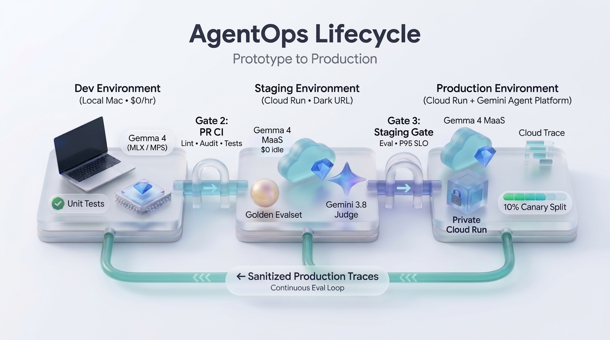
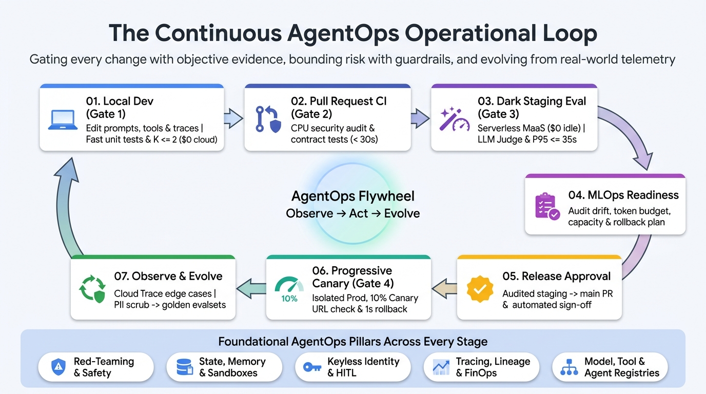

# AgentOps on Google Cloud: ADK & Gemma 4

[](https://www.python.org/downloads/)
[](https://google.github.io/adk-docs/)
[](https://huggingface.co/collections/google/gemma-4)
[](https://cloud.google.com/run)
[](https://cloud.google.com/vertex-ai)

A production-grade, open-weights AI agent built with Google Agent Development Kit (ADK) and Gemma 4, providing hardware sizing, GPU serving cost calculations, and capacity planning across local Apple Silicon and Google Cloud environments.

> [!NOTE]
> **Looking for the step-by-step tutorial?** See the [3-Stage AgentOps Walkthrough Guide](./README.md) for the hands-on guide covering local Mac prototyping, Cloud Run staging evaluation, and production canary deployment.

---

## Architecture Overview



The advisor agent runs natively on Google ADK (`app/agent.py`) using `GemmaEndpointLlm` (`app/gemma_llm.py`), a zero-proxy `BaseLlm` adapter that connects to:

- **Local Dev (`AGENT_ENV=dev`)**: Warm local Gemma server running in Apple Silicon unified memory (`mlx` / `mps`).
- **Cloud Staging (`AGENT_ENV=staging`)**: Private Cloud Run revision connected to serverless Gemini Agent Platform Gemma 4 MaaS (`google/gemma-4-26b-a4b-it-maas`) on the `global` endpoint (`$0` idle GPU cost).
- **Production (`AGENT_ENV=prod`)**: Auto-scaling Cloud Run service connected to serverless Gemini Agent Platform Gemma 4 MaaS (`global`), scaling with Gemini Agent Platform Provisioned Throughput (PT) when guaranteed high-QPS capacity is needed.

### FinOps Tools & Capabilities

1. **`estimate_gemma_vram`**:
   - Calculates exact model weight memory and KV-cache headroom across precisions (`bfloat16`, `8bit`, `4bit`).
   - Maps total memory requirements to recommended Apple Silicon and cloud GPU hardware tiers.

2. **`calculate_serving_cost`**:
   - Calculates monthly GPU serving costs based on active hours per day and replica count.
   - Computes financial savings achieved by off-hours hibernation compared to 24x7 continuous operation.

3. **`size_endpoint_capacity`**:
   - Calculates total burst LLM RPCs accounting for the agentic Work Multiplier (`K = 2`).
   - Recommends minimum and maximum GPU replica counts and Cloud Run instances for target concurrent users and P95 latency.

---

## Quickstart: Running Locally (< 2 Minutes)

### Prerequisites

- **Python & `uv`**: Python `>= 3.13` and [`uv`](https://docs.astral.sh/uv/)
- **Google Cloud SDK (`gcloud`)**: Installed and authenticated (`gcloud auth login` and `gcloud auth application-default login`)
- **GitHub CLI (`gh`)**: Installed and authenticated (`gh auth login`) for PR workflows and WIF variable registration
- **Hugging Face Token (`HF_TOKEN`)**: [Read token](https://huggingface.co/settings/tokens) with the Gemma license accepted (for local Stage 1 serving)
- **Google Cloud Projects & GitHub Topology**: Isolated `staging-project` and `prod-project` Google Cloud projects (billing enabled; zero regional GPU quota required for Gemini Agent Platform Gemma 4 MaaS) and a standalone GitHub repository with `dev`, `staging`, and `main` branches

### Installation

```bash
# 1. Clone your standalone repository
git clone https://github.com/<OWNER>/adk-gemma-agentops.git
cd adk-gemma-agentops

# 2. Configure environment
cp .env.example .env
# Edit .env and replace HF_TOKEN with your Hugging Face read token

# 3. Install dependencies via uv
uv sync --all-extras
```

### Run the Agent

```bash
# Terminal 1: Start local warm Gemma server in Apple unified memory (MLX 4-bit)
uv run python model_serving/gemma_server.py --engine mlx

# Terminal 2: Query the agent directly via CLI
AGENT_ENV=dev uv run adk run app "How much VRAM does gemma-4-26B-A4B-it with 4bit quantization need?"
```

---

## Verification & Promotion Gates

The repository includes a 4-gate verification suite enforcing mathematical accuracy, trajectory integrity, and efficiency:



```text
                ▲
               / \       Gate 4: Production Canary Gate
              /   \      10% Canary traffic split + SLO validation -> 100%
             /─────\
            /       \     Gate 3: Staging Pre-Production Gate
           /         \    3A: Gemini 3.8 Flash Judge (trajectory = 1.0, response >= 0.85)
          /           \   3B: Dark-URL concurrency & P95 SLO gate
         /─────────────\
        /               \  Gate 2: Pull Request CI Gate
       /                 \ ruff + pytest + pip-audit (< 30s)
      /───────────────────\
     /                     \ Gate 1: Local Pre-Commit Gate
    /                       \ pytest (< 0.2s) + Work Multiplier audit (K <= 2)
   └─────────────────────────┘
```

### 1. Gate 1: Fast Deterministic Unit Tests & Work Multiplier Check

Runs hermetic unit tests verifying tool math formulas, dynamic MaaS routing, OpenAI tool-turn wire shape, and asserting the single-user Work Multiplier (`K <= 2`):

```bash
uv run pytest -v tests/unit/test_agent_unit.py -k "not integration"
```

### 2. Gate 1: Local Trajectory & Lexical Evaluation

Executes offline evaluation against the golden dataset without calling cloud APIs:

```bash
AGENT_ENV=dev uv run adk eval app ./tests/eval/evalsets/golden.evalset.json \
  --config_file_path=./tests/eval/eval_config_local.json \
  --print_detailed_results
```

### 3. Gate 3A: Staging Semantic Evaluation (Gemini 3.8 Flash Judge)

Evaluates semantic response quality, hallucinations, and safety against serverless Gemini Agent Platform Gemma 4 MaaS using Gemini 3.8 Flash as an independent judge:

```bash
AGENT_ENV=staging USE_MAAS=1 GOOGLE_GENAI_USE_VERTEXAI=1 \
GOOGLE_CLOUD_PROJECT="$GOOGLE_CLOUD_PROJECT" GOOGLE_CLOUD_LOCATION="global" \
uv run adk eval app ./tests/eval/evalsets/golden.evalset.json \
  --config_file_path=./tests/eval/eval_config.json \
  --print_detailed_results
```

### 4. Gate 3B: Dark-URL Concurrency & Latency Gate (Cloud Run Dark Revision)

Validates private IAM authentication, ADK session affinity, and `P95 <= 35s` latency against the Cloud Run staging dark revision (`--tag staging-dark`).

```bash
# Extract the dedicated dark revision URL
DARK_URL=$(gcloud run services describe gemma-agent-staging \
  --region "us-west1" \
  --project "$GOOGLE_CLOUD_PROJECT" \
  --format="value(status.traffic.filter(tag=staging-dark).extract(url).flatten())")

# Execute 5-user concurrent multi-turn smoke & latency check
uv run python tests/load/load_test_cloud_run.py \
  --url "$DARK_URL" \
  --bearer-token "$(gcloud auth print-identity-token)" \
  --users 5 --concurrency 5 --ramp-seconds 2

# Once Gates 3A and 3B pass, shift 100% staging traffic to the validated revision
gcloud run services update-traffic gemma-agent-staging \
  --region "us-west1" \
  --project "$GOOGLE_CLOUD_PROJECT" \
  --to-tags staging-dark=100
```

---

## Environment Matrix & Configuration

| Variable | Description | Default | Allowed Values |
| :--- | :--- | :--- | :--- |
| `AGENT_ENV` | Active environment tier | `dev` | `dev`, `staging`, `prod` |
| `GEMMA_SERVER_URL` | Local OpenAI-compatible server URL | `http://127.0.0.1:8080/v1` | URL string |
| `GEMMA_MODEL_ID` | Local Hugging Face / MLX model ID | `mlx-community/gemma-3-12b-it-4bit` | Repo ID string |
| `USE_MAAS` | Route directly to Gemini Agent Platform Gemma 4 MaaS (`global`) | `1` (in `staging`/`prod`) | `0` (off), `1` (on) |
| `GEMMA_MAAS_MODEL_ID` | Gemini Agent Platform MaaS model ID | `google/gemma-4-26b-a4b-it-maas` | Gemini Agent Platform MaaS model string |
| `GOOGLE_CLOUD_PROJECT` | Google Cloud project ID | `""` | Google Cloud project ID |
| `GOOGLE_CLOUD_LOCATION` | Gemini Agent Platform location (`global` for MaaS & Gemini Judge) | `global` | `global` |
| `GCP_REGION` | Cloud Run deployment region | `us-west1` | Region string (e.g. `us-west1`) |
| `DATA_GOVERNANCE_TIER` | Enforced data tier | Auto-derived | `synthetic_fixtures_only`, `anonymized_staging_snapshot`, `live_production_data` |

---

## CI/CD Automation (GitHub Actions)

Production-ready workflow templates are maintained in `cicd/`:

- **`cicd/agent-ci-pr.yml`**: Gate 2 PR workflow running `pip-audit`, `ruff`, and `pytest` on CPU in < 30 seconds (`$0` cloud cost).
- **`cicd/agent-cd-staging.yml`**: Gate 3 staging deployment pipeline triggered on merge to `staging`.
- **`cicd/agent-cd-prod.yml`**: Gate 4 production deployment with 10% canary traffic shift on merge to `main`.

### Keyless Authentication Standard (Workload Identity Federation)

Workload Identity Federation (OIDC) eliminates long-lived service account JSON keys by exchanging short-lived GitHub Actions OIDC tokens scoped to your exact repository (`assertion.repository`). Provision all required Google Cloud APIs, Artifact Registry (`cloud-run-source-deploy`), least-privilege IAM bindings, WIF Pool/Provider, and GitHub Repository Variables in one command via [`cicd/setup_wif.py`](./cicd/setup_wif.py) (see [`cicd/README.md`](./cicd/README.md) for the full IAM role matrix and manual `gcloud` commands):

```bash
export GITHUB_REPO=$(gh repo view --json nameWithOwner -q .nameWithOwner)

# Configure Staging IAM, WIF, and GitHub Variables
uv run python cicd/setup_wif.py --env staging --project "staging-project" --region "us-west1" --repo "$GITHUB_REPO"

# Configure Production IAM, WIF, and GitHub Variables
uv run python cicd/setup_wif.py --env prod --project "prod-project" --region "us-west1" --repo "$GITHUB_REPO"
```

To activate the automated CI/CD gates:

```bash
mkdir -p .github/workflows
cp cicd/*.yml .github/workflows/

# Monitor Gate 3 pipeline runs and verify automatic Cloud Run promotion
gh run list --branch staging --limit 5
RUN_ID=$(gh run list --branch staging --limit 1 --json databaseId -q '.[0].databaseId')
gh run watch "$RUN_ID"

# Verify Cloud Run traffic status
gcloud run services describe gemma-agent-staging \
  --region "us-west1" \
  --project "$GOOGLE_CLOUD_PROJECT" \
  --flatten="status.traffic[]" \
  --format="table(status.traffic.revisionName:label=REVISION,status.traffic.percent:label=TRAFFIC_PCT,status.traffic.tag:label=TAG,status.traffic.url:label=URL)"
```

---

## Repository Structure

```text
adk-gemma-agentops/
├── .dockerignore             # Keeps local assets/tests/caches out of Cloud Run images
├── .env.example              # Environment variables template
├── .gitignore                # Git ignore rules
├── .python-version           # Pinned Python version (3.13)
├── Dockerfile                # Container build descriptor for Cloud Run (Python 3.13 + uv)
├── pyproject.toml            # Project dependencies and packaging
├── uv.lock                   # Locked dependency graph for reproducible uv sync
├── README.md                 # Production application documentation (this file)
├── app/
│   ├── __init__.py           # Application package export
│   ├── agent.py              # ADK agent, FinOps tools & data-governance helpers
│   ├── gemma_llm.py          # Zero-proxy BaseLlm adapter (local & Gemini Agent Platform MaaS)
│   └── tool_parser.py        # Shared zero-dependency JSON/AST tool-call parser
├── assets/
│   ├── agentops-3d-panoramic-lifecycle.jpg # 3D architecture lifecycle diagram
│   └── agentops-operational-loop.jpg       # Continuous 7-step AgentOps flywheel diagram
├── cicd/
│   ├── README.md             # Keyless WIF, IAM role matrix & manual gcloud guide
│   ├── setup_wif.py          # One-command Google Cloud API, IAM & GitHub WIF bootstrapper
│   ├── agent-ci-pr.yml       # Gate 2: PR fast test, lint & pip-audit workflow
│   ├── agent-cd-staging.yml  # Gate 3: Dark deploy, eval & dark-URL SLO gate
│   └── agent-cd-prod.yml     # Gate 4: 10% Canary deployment & promote
├── environments/
│   ├── dev.env.example       # Local development settings (synthetic fixtures)
│   ├── staging.env.example   # Staging settings (anonymized data, Gemma 4 MaaS)
│   └── prod.env.example      # Production settings (Gemma 4 MaaS)
├── model_serving/
│   └── gemma_server.py       # Local OpenAI-compatible server (MLX / MPS)
└── tests/
    ├── eval/
    │   ├── eval_config.json       # Staging evaluation criteria & thresholds
    │   ├── eval_config_local.json # Local evaluation criteria (zero cloud call)
    │   └── evalsets/
    │       └── golden.evalset.json # Ground-truth multi-turn evaluation cases
    ├── load/
    │   └── load_test_cloud_run.py # End-to-end Cloud Run concurrency & SLO checker
    ├── scenarios/
    │   ├── inject_h200_eval_case.py  # Closed-loop Test Case 1 trace injector
    │   └── apply_h200_pricing_fix.py # Closed-loop Test Case 2 local TDD fix
    └── unit/
        └── test_agent_unit.py     # Deterministic unit tests & K<=2 audit
```

---

## Clean Up Cloud Resources

Gemini Agent Platform Gemma 4 MaaS is pay-per-token (`$0` idle cost), while Cloud Run services (`--min-instances=1`) incur recurring charges. Delete the two dedicated Google Cloud projects to stop all recurring charges and remove Cloud Run, Artifact Registry images, service accounts, and WIF pools (only run on dedicated projects; on shared projects, delete only the two Cloud Run services instead):

```bash
# Dedicated projects (permanently deletes all resources inside each project):
gcloud projects delete "$GOOGLE_CLOUD_PROJECT" --quiet
gcloud projects delete "$PROD_PROJECT_ID" --quiet

# Shared projects alternative (deletes only the two Cloud Run services):
# gcloud run services delete gemma-agent-staging --region="$GCP_REGION" --project="$GOOGLE_CLOUD_PROJECT" --quiet
# gcloud run services delete gemma-agent-prod --region="$GCP_REGION" --project="${PROD_PROJECT_ID:-$GOOGLE_CLOUD_PROJECT}" --quiet
```

- **Hugging Face token**: Delete the read token at [huggingface.co/settings/tokens](https://huggingface.co/settings/tokens) and remove your local `.env` (`rm -f .env`).
- **GitHub repository (optional)**: Delete your standalone `adk-gemma-agentops` repo from GitHub Settings (or with `gh repo delete`) and remove the local folder.

---

## References

- [Google ADK Documentation](https://google.github.io/adk-docs/)
- [Gemma Open Models on Hugging Face](https://huggingface.co/collections/google/gemma-4)
- [Gemini Agent Platform Model Garden (Gemma docs)](https://cloud.google.com/vertex-ai/generative-ai/docs/open-models/use-gemma)
- [Cloud Run Documentation](https://cloud.google.com/run/docs)

---

## Author

- [Pedro Melendez](https://github.com/pemujo)
