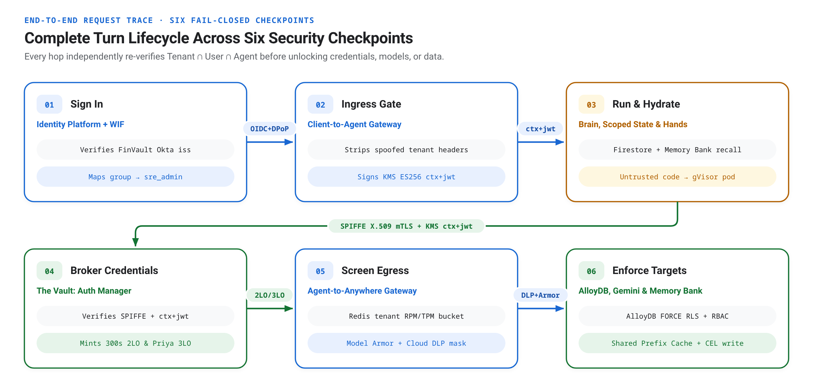
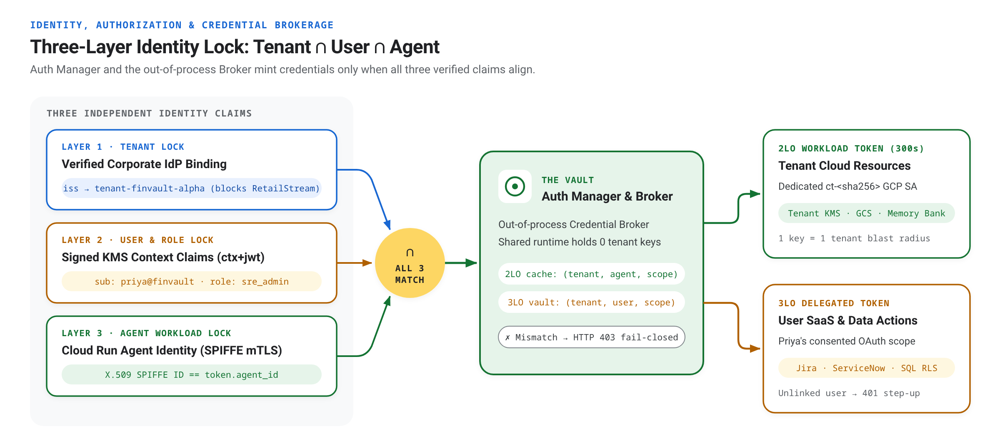

# Pooled Multi-Tenant AI Agents on Google Cloud

| Authors |
| --- |
| [Jigyasu Juneja](https://github.com/jigyasujuneja), Daniel Lee, Nithin Reddy Cheruku, Dhawal Patel, Eduardo Gonzalez, Joyce Chen, Navneet Tuteja, Smitha Venkat |

## Agent details

| Property | Value |
| --- | --- |
| **Interaction Type** | Multi-turn conversational with out-of-process sandbox diagnostics |
| **Complexity** | Advanced |
| **Agent Type** | Multi-tenant governed agent pool (`Tenant ∩ User ∩ Agent` isolation) |
| **Vertical** | Site Reliability Engineering / Regulated B2B SaaS (Banking and Retail) |
| **Architecture** | Stateless Cloud Run orchestrator, ephemeral sandboxes, and out-of-process credential broker |
| **Model** | Gemini 4 Hydrogen (`gemini-4-hydrogen`) and Gemini 4 Carbon (`gemini-4-carbon`) |
| **Framework** | FastAPI, `google-genai`, Terraform |

Companion code sample for **Building Multi-Tenant AI Agents on Google Cloud,
Part 2: The Pooled Architecture**. It models **Cymbal CloudOps**, a B2B SaaS
provider serving **FinVault Bank** (Enterprise tier) and **RetailStream**
(Standard tier) on shared Google Cloud infrastructure. Each hop enforces
`Tenant ∩ User ∩ Agent` isolation outside the model.

> **Disclaimer:** This is a reference sample using synthetic tenants and is not
> an officially supported Google product.

## Architecture



## Quickstart

Prerequisites: Python 3.11+ and `uv` (no Google Cloud account is required for
local mode).

Run the 6-checkpoint incident investigation for a **FinVault Bank** SRE admin
(`priya@finvault.example.com`) followed by 6 cross-tenant breach checks:

```bash
cd agents/pooled-multi-tenant-agents
uv sync --extra dev
uv run python demo.py
```

Run the test suite:

```bash
uv run pytest -v
```

Start the FastAPI gateway locally and verify health:

```bash
uv run uvicorn app.main:app --reload --port 8080
curl http://localhost:8080/healthz
```

Admin offboarding (`POST /api/v1/tenants/{tenant_id}/offboard`) requires the
`X-Platform-Admin-Token` header matching `CYMBAL_PLATFORM_ADMIN_TOKEN`.

## Code map

Each module maps directly to a section of the Part 2 Pooled Architecture guide:

| Blog section | Path | What it implements |
| --- | --- | --- |
| **1. Identity, Ingress, and The Vault** | `app/identity.py`, `app/config.py` | Issuer-bound OIDC federation, RFC 9449 EC P-256 DPoP with replay protection, ES256 `ctx+jwt` signing and public-key-only verification, role-intersected scopes, and the `2LO`/`3LO` **Auth Manager** credential broker. |
| **2. Compute: The Brain and The Hands** | `app/orchestrator.py` | Stateless turn orchestrator, two-tier dynamic runtime skills (shared baseline vs. per-tenant), and a local policy simulator for zero-credential **agent sandboxes in Gemini**. |
| **3. Session and Memory Layer** | `app/memory.py` | Per-tenant AES-256-GCM AEAD session checkpoints with KMS key disablement on offboarding, plus **Memory Bank in Gemini** Controls 1, 2, 3A, and 3B. |
| **4. Egress, Routing, and Data Layer** | `app/egress.py`, `app/data.py`, `app/schema.sql` | Local egress injection/DLP policy stub, per-tenant RPM/TPM quota bulkheads, governed **Gemini 4 Hydrogen / Carbon** routing with shared immutable prefix keys, **AlloyDB for PostgreSQL** `FORCE ROW LEVEL SECURITY` DDL, and 3LO Jira actions. |
| **Infrastructure** | `terraform/` | Issuer-bound **Workload Identity Federation (WIF)** providers, **Cloud KMS** signing and per-tenant CMEK keys, **Cloud Run** gateway service, and **Memory Bank in Gemini** `roles/aiplatform.memoryUser` IAM CEL conditions. |
| **Entry points and tests** | `demo.py`, `app/main.py`, `tests/` | Interactive 6-checkpoint trace, FastAPI HTTP boundary, and automated isolation and RLS contract tests. |

## Local mode vs. Google Cloud

| Layer | Local mode (default) | Google Cloud deployment |
| --- | --- | --- |
| **Cryptography (`DPoP`, `ctx+jwt`, AEAD)** | Real EC P-256 `ES256`, RFC 9449 DPoP, and AES-256-GCM with HMAC-derived keys. | Cloud KMS HSM `EC_SIGN_P256_SHA256` and per-tenant CMEK keys (`terraform/main.tf`). |
| **Gemini models** | Deterministic local synthesis (no API calls). | Set `CYMBAL_LIVE_GEMINI=1` with `GOOGLE_GENAI_USE_VERTEXAI=true` and `GOOGLE_CLOUD_LOCATION=global` to call live `gemini-4-hydrogen` / `gemini-4-carbon` via `google-genai`. |
| **AlloyDB RLS and Memory Bank CEL** | In-process Python adapters enforcing the same predicates. | Apply `app/schema.sql` to AlloyDB for PostgreSQL and `terraform/wif_and_memory_cel.tf` to Cloud IAM. |
| **Sandboxes and egress guardrails** | Local regex policy simulator (`IsolatedSandboxRunner`, `EgressGuardrails`); no arbitrary code execution. | **Agent sandboxes in Gemini** (gVisor), **Model Armor**, and **Cloud DLP**. |
| **Session and quota stores** | In-memory dictionaries with immediate eviction hooks. | **Cloud Firestore** / **sessions in Gemini** and **Memorystore for Redis**. |



## Deploying to Google Cloud

Prerequisites: `gcloud`, Terraform >= 1.6, and a Google Cloud project with
billing enabled.

1. Enable required APIs and build the gateway container with Cloud Build:

```bash
export PROJECT_ID="your-google-cloud-project-id"
export REGION="us-central1"
export IMAGE="${REGION}-docker.pkg.dev/${PROJECT_ID}/cymbal-agents/pooled-gateway:v1"

gcloud config set project "${PROJECT_ID}"
gcloud services enable \
  run.googleapis.com \
  cloudbuild.googleapis.com \
  artifactregistry.googleapis.com \
  cloudkms.googleapis.com \
  aiplatform.googleapis.com \
  iam.googleapis.com

gcloud artifacts repositories create cymbal-agents \
  --repository-format=docker \
  --location="${REGION}"

# On brand-new projects, grant the default Compute Engine build service account
# permission to read source archives, write build logs, and push images:
PROJECT_NUMBER="$(gcloud projects describe "${PROJECT_ID}" --format='value(projectNumber)')"
for role in roles/cloudbuild.builds.builder roles/storage.objectViewer roles/artifactregistry.writer roles/logging.logWriter; do
  gcloud projects add-iam-policy-binding "${PROJECT_ID}" \
    --member="serviceAccount:${PROJECT_NUMBER}-compute@developer.gserviceaccount.com" \
    --role="${role}" >/dev/null
done

gcloud builds submit --tag "${IMAGE}" .
```

> Note: On a newly created project, wait ~30 seconds after `gcloud services enable` if `gcloud artifacts repositories create` reports propagation delay.

2. Copy `terraform/terraform.tfvars.example` to `terraform/terraform.tfvars`,
   set `project_id`, `region`, and `gateway_image` to `${IMAGE}`, and apply:

```bash
terraform -chdir=terraform init
terraform -chdir=terraform plan
terraform -chdir=terraform apply
```

This provisions the Cloud KMS keys, per-tenant service accounts, WIF issuer
locks, Memory Bank IAM CEL policies, and the Cloud Run gateway configured with
`CYMBAL_LIVE_GEMINI=1`, `GOOGLE_GENAI_USE_VERTEXAI=true`, and
`GOOGLE_CLOUD_LOCATION=global` (`gemini-4-hydrogen` and `gemini-4-carbon`).

3. Apply `app/schema.sql` to an existing **AlloyDB for PostgreSQL** (or Cloud
   SQL for PostgreSQL) cluster with `DATABASE_URL` set to create the
   `cymbal_mcp_app` role and `FORCE ROW LEVEL SECURITY` policies:

```bash
psql "${DATABASE_URL}" -f app/schema.sql
```

4. Verify the deployed service health endpoint. By default, Terraform configures
   `INGRESS_TRAFFIC_INTERNAL_LOAD_BALANCER` (so direct workstation requests
   return `404` until fronted by an Internal Load Balancer or IAP). To test
   `/healthz` directly from your workstation with IAM authentication, set
   `gateway_ingress = "INGRESS_TRAFFIC_ALL"` in `terraform/terraform.tfvars`,
   re-apply, grant yourself `roles/run.invoker`, and run:

```bash
gcloud run services add-iam-policy-binding cymbal-pooled-gateway \
  --region="${REGION}" \
  --member="user:$(gcloud config get-value account)" \
  --role="roles/run.invoker"

curl -H "Authorization: Bearer $(gcloud auth print-identity-token)" \
  "$(terraform -chdir=terraform output -raw gateway_uri)/healthz"
```

5. Clean up provisioned resources when finished:

```bash
terraform -chdir=terraform destroy
```

To run the local CLI against live Gemini 4 without deploying Cloud Run, set the
environment variables in `.env.example` (`CYMBAL_LIVE_GEMINI=1`,
`GOOGLE_CLOUD_PROJECT`, `GOOGLE_CLOUD_LOCATION=global`,
`GOOGLE_GENAI_USE_VERTEXAI=true`) and run `uv run python demo.py`.
