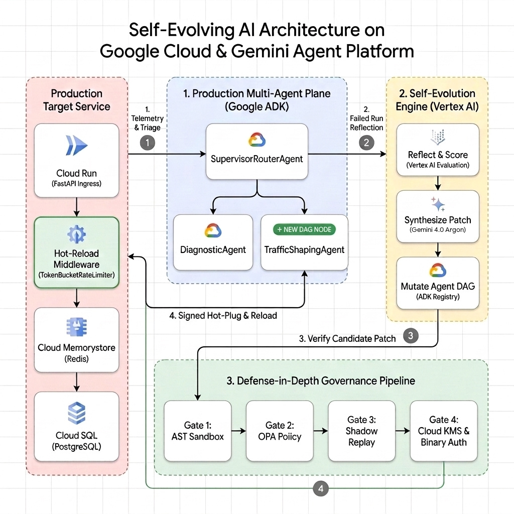

# Architecting Governed, Self-Evolving AI Agents on Gemini Enterprise Agent Platform (Project Chrysalis)

[](https://cloud.google.com/)
[](https://pypi.org/project/google-adk/)
[-EA4335)](https://cloud.google.com/products/agent-platform)
[](https://cloud.google.com/security)

| Author |
| --- |
| [Anant Nawalgaria](https://github.com/anantnawal) |

Project Chrysalis is a reference implementation of a **governed, self-evolving AI agent system** for Site Reliability Engineering. It layers an enterprise **Security & Governance Control Plane** around the **Google ADK 2.0 Multi-Agent Framework** and **Gemini 4.0 Argon on Agent Platform** (in your own Google Cloud project), and integrates real Google Cloud services where it matters for the self-evolution loop: Gemini-synthesized hotpatches signed with **Cloud KMS**, Dream-RSI counterfactual sweeps executed as SQL in **BigQuery**, and audit/telemetry streamed to **Cloud Logging**.

> 📖 **Read the Full Google Cloud Blog Post:**
> For an intuitive, end-to-end breakdown of Self-Evolving AI, Recursive Self-Improvement (RSI), the Black Friday SRE use case, cloud architecture, and mathematical attribution formulas, see [Architecting Governed, Self-Evolving AI Agents on Gemini Enterprise Agent Platform](https://developers.googleblog.com/architecting-governed-self-evolving-ai-agents-on-gemini-agent-platform).



## Agent Details

| Property | Value |
| --- | --- |
| **Interaction Type** | Autonomous (event-driven), with a Human-in-the-Loop approval gate |
| **Complexity** | Advanced |
| **Agent Type** | Multi-Agent (Supervisor + specialist sub-agents, with runtime topology evolution) |
| **Vertical** | Site Reliability Engineering / Cloud Operations |
| **ADK Pattern** | `LlmAgent` hierarchy + `FunctionTool`s + in-memory `Runner` re-binding |
| **Model** | `gemini-4-argon` (Gemini 4.0 Argon), configurable via `GEMINI_MODEL` |
| **Framework** | [Google Agent Development Kit (ADK)](https://google.github.io/adk-docs/) |

---

## 1. Cloud Architecture & Google Cloud Services Integration

| Subsystem | Production Target | What runs in this sample |
| :--- | :--- | :--- |
| **Agents** (`Supervisor`, `Diagnostic`, `Distiller`, `Chaos`, evolved `TrafficShaping`) | Google ADK 2.0 (e.g. on Gemini Enterprise Agent Platform) | **Real** ADK agents calling **Gemini on Agent Platform**, running locally in-process |
| **APEX Layer 1 hotpatch** | Gemini code synthesis | **Real**: Gemini writes the `TokenBucketRateLimiter` from the live diagnosis; sandbox gates verify it before it is mounted |
| **Code signing / Binary Authorization** | Cloud KMS asymmetric signing | **Real Cloud KMS** (RSA-PSS, verified against the key's public key) once provisioned via `scripts/setup_gcp.sh`; HMAC fallback otherwise |
| **Offline Replay (Dream-RSI)** | BigQuery | **Real BigQuery** load job + SQL counterfactual sweep once provisioned; identical local engine otherwise (output is labelled) |
| **Principle Store** | Vector Search | Agent Platform **text-embedding-004** embeddings (real) in an in-memory vector index |
| **Telemetry & Audit** | Cloud Logging & Monitoring | **Real Cloud Logging** writes (batched, non-blocking) |
| **Cache Tier** | Cloud Memorystore (Redis) | Local in-memory LRU simulation |
| **Database Tier** | Cloud SQL | Local SQLite + 2-slot connection-pool semaphore simulation |
| **Model Armor** | Model Armor API | Local prompt-injection / PII regex shield modelled on Model Armor |

### 1.1 Provision the Google Cloud resources (optional)

```bash
scripts/setup_gcp.sh          # prints the plan and asks for confirmation; idempotent
scripts/teardown_gcp.sh       # deletes the BigQuery dataset and destroys the KMS key version
```

> [!WARNING]
> Cloud KMS key rings and keys cannot be deleted (only key versions can be destroyed). A software key version costs about USD 0.06/month.

`setup_gcp.sh` enables the required APIs, creates the BigQuery dataset `chimera_telemetry` (+ `recorded_requests` table) and the Cloud KMS key `chimera-governance-ring/chimera-patch-signer` (`RSA_SIGN_PSS_2048_SHA256`). Without these resources everything still runs; BigQuery/KMS steps fall back to local implementations and say so in the output.

> [!NOTE]
> The Google Cloud resource identifiers (`chimera_telemetry`, `chimera-governance-ring`, `chimera-patch-signer`, and the Cloud Logging logs `chimera-security-audit` / `chimera-spans`) keep the project's original codename so that already-provisioned resources continue to work. The BigQuery dataset can be overridden with `CHRYSALIS_BQ_DATASET`.

---

## 2. Google Cloud Security & Governance Framework

```text
+---------------------------------------------------------------------------------------------------------+
|                                CHRYSALIS GOVERNANCE CONTROL PLANE                                         |
+---------------------------------------------------------------------------------------------------------+
         |                                |                               |
         v                                v                               v
+------------------+             +------------------+            +------------------+
|  1. MODEL ARMOR  |             |  2. CLOUD KMS    |             |  3. POLICY-AS-   |
|   INGRESS SHIELD |             |  PROVENANCE & BA |             |      CODE (OPA)  |
+------------------+             +------------------+            +------------------+
| • Prompt injection             | • Digitally signs|            | • Enforces SLA   |
|   detection & block            |   APEX tools &   |             |   rate floors    |
| • DLP PII masking              |   principles.    |            |   (>= 10 req/s)  |
|   (JWT, card #s)               | • Binary Auth    |            | • Blocks reboot  |
| • Sanitizes inputs             |   middleware     |             |   or drop tables |
+------------------+             +------------------+            +------------------+
         |                                |                               |
         +--------------------------------+-------------------------------+
                                          |
         +--------------------------------+-------------------------------+
         |                                                                |
         v                                                                v
+----------------------------------+            +----------------------------------+
|      4. HITL DUAL-CUSTODY        |            |    5. CLOUD AUDIT LOGGING        |
|    (Tiered Autonomy Gate)        |            |       (Tamper-Evident Trail)     |
+----------------------------------+            +----------------------------------+
| • Tier 0: Read-only diagnostics  |            | • Streams structured events to   |
| • Tier 1: Canary hotpatches      |            |   Google Cloud Logging           |
| • Tier 2: Topology mutation      |            |   (chimera-security-audit)       |
|   requires human SRE approval    |            | • Immutable non-repudiation      |
+----------------------------------+            +----------------------------------+
```

### The 5 Security & Governance Pillars

1. **Model Armor-style Ingress Shield** (`app/governance/model_armor.py`):
   - Scans incoming HTTP request payloads and every incident alert / directive before it reaches Gemini 4.0 Argon.
   - Detects and neutralizes prompt injection attempts (e.g. `IGNORE PREVIOUS INSTRUCTIONS`, `developer mode`, `drop database`).
   - Masks PII and secrets (credit cards, JWT Bearer tokens, API keys, emails) with local regex filters (a production deployment would call the Model Armor API).

2. **Google Cloud KMS Cryptographic Provenance** (`app/governance/kms_signer.py`):
   - Gemini-synthesized APEX Layer 1 tools (`TokenBucketRateLimiter`) and Layer 2 operational principles are hashed (SHA-256) and signed with **Google Cloud KMS** (`chimera-governance-ring/cryptoKeys/chimera-patch-signer`, RSA-PSS 2048).
   - **Binary Authorization Middleware Gate:** before mounting a dynamic tool, the server re-verifies the signature against the exact source code using the KMS public key; tampered or unsigned code is rejected.

3. **Deterministic Policy-as-Code Controller (OPA style)** (`app/governance/policy_controller.py`):
   - Enforces invariant SLAs on every hotpatch *and* on every `set_rate_limit` call made by the evolved `TrafficShapingAgent`:
     - Guaranteed minimum admission rate floor ($\ge 10.0$ req/s).
     - Maximum burst capacity ceiling ($\le 100$).
     - Strictly forbids destructive actions (`reboot_database`, `flush_db_connections`, `drop_database`).

4. **Tiered Autonomy & Human-in-the-Loop (HITL) Gate** (`app/governance/hitl_gate.py`):
   - **Tier 0 (Diagnostics):** Fully autonomous read-only telemetry queries.
   - **Tier 1 (Tuning):** Autonomous rate-limiting hotpatching under policy invariants.
   - **Tier 2 (Structural Mutation):** Multi-agent topology rewiring (commissioning `TrafficShapingAgent`) requires an explicit SRE dual-custody approval token (`SRE-SIG-...`).

5. **Tamper-Evident Cloud Audit Trail** (`app/governance/audit_logger.py`):
   - Pushes structured JSON audit records directly into **Google Cloud Logging** under `projects/<PROJECT_ID>/logs/chimera-security-audit`.

---

## 3. How to Run the Demonstration & Web Console

### 3.1 Environment Setup & Credentials

```bash
git clone https://github.com/GoogleCloudPlatform/generative-ai.git
cd generative-ai/agents/self-evolving-ai

python3 -m venv .venv
source .venv/bin/activate
pip install -r requirements.txt

# Optional: authenticate for live Agent Platform Gemini calls
# (Runs out-of-the-box with deterministic fallbacks if Google Cloud credentials are not set)
gcloud auth application-default login
export GOOGLE_CLOUD_PROJECT="your-gcp-project-id"   # optional: defaults to your gcloud / ADC project
export GOOGLE_CLOUD_LOCATION="global"
export GOOGLE_CLOUD_REGION="us-central1"
```

All commands below are run from the `agents/self-evolving-ai` directory.

---

### 3.2 Interactive Web Console (Port 8009)

Start the target environment server with the web UI:

```bash
.venv/bin/uvicorn app.target_env.server:app --host 127.0.0.1 --port 8009
```

Then open the browser console at `http://127.0.0.1:8009/ui`.

The Web UI displays:

- **Telemetry Dials:** Real-time P99 latency, HTTP 5xx error rate, Cloud SQL connection pool saturation, and Memorystore hit ratio.
- **Google Cloud Governance Bar:** Live indicators for Model Armor, Cloud KMS Binary Authorization verification, and Cloud Policy Controller.
- **Active ADK Multi-Agent Topology:** Visual graph showing `SupervisorRouterAgent`, `DiagnosticAgent`, and post-evolution `TrafficShapingAgent`.

Drive the four phases with the dashboard buttons. Each button calls the live server API, which runs the real ADK agents and Gemini (expect ~10–35 s per agent step), so the event console shows what the agents actually did and the dials reflect real server telemetry:

| Button | Backend work |
| :--- | :--- |
| 1. Surge | 50 concurrent requests against the 2-slot pool → real timeouts / HTTP 500s |
| 2. Hotpatch | `SupervisorRouterAgent` → `DiagnosticAgent` triage (live tool calls); Gemini synthesizes the limiter from the diagnosis; sandbox gates → Policy Controller → KMS signature → Binary Authorization → limiter mounted on `/checkout` |
| 3. Distill & HITL | Credit attribution; Gemini `PrincipleDistillerAgent` publishes a KMS-signed principle into the shared Self-Navigating memory; Tier-2 approval modal mutates the live ADK graph |
| 4. Dream-RSI & Chaos | Counterfactual sweep (BigQuery SQL when provisioned); the evolved supervisor delegates to `TrafficShapingAgent`, whose policy-checked `set_rate_limit` retunes the live limiter; Gemini `CuriosityChaosAgent` probes a shadow sandbox |

### 3.3 End-to-End CLI Demonstration

The CLI demo runs its own in-process environment and is independent of the web server:

```bash
.venv/bin/python3 demo_runner.py
```

What happens in each phase:

- **Phase 1:** Black Friday surge hits the simulated Memorystore/Cloud SQL tier. The 2-slot connection pool starves, so most cold-cache requests return HTTP 500 and P99 latency spikes.
- **Phase 2:** Model Armor scans the alert and the ADK supervisor routes to the diagnostic agent. Gemini then synthesizes the `TokenBucketRateLimiter` from that diagnosis; it must pass the AST sandbox policy, a restricted compile and 5 behavioural tests (with repair attempts) before the Policy Controller approves it, Cloud KMS signs it and Binary Authorization re-verifies and mounts it. Errors drop to **0.0%** in the burst.
- **Phase 3:** AgentEvolver calculates credit scores (the database reboot is a counterfactual replay, never executed), the ADK `PrincipleDistillerAgent` publishes a KMS-signed invariant, and the Tier-2 HITL gate approves commissioning `TrafficShapingAgent`.
- **Phase 4:** Dream-RSI runs 400 counterfactual sweeps (as SQL in BigQuery when provisioned). The evolved supervisor delegates to `TrafficShapingAgent` to apply the optimal policy to the live limiter, and the ADK `CuriosityChaosAgent` runs a shadow chaos probe (cache purge + 200-request burst), reporting **`VERIFIED_RESILIENT`** only when zero HTTP 500s occur.

---

### 3.4 Running Automated Unit Tests

Run the complete test suite (48 unit and integration tests across 7 test modules):

```bash
.venv/bin/pytest tests/ -v
```

```text
============================= test session starts ==============================
tests/test_adk_platform_agents.py ..                                     [  4%]
tests/test_bigquery_dream_rsi.py .                                       [  6%]
tests/test_cloud_services.py ...                                         [ 13%]
tests/test_code_synthesis.py ............                                [ 39%]
tests/test_comprehensive_audit.py ...................                    [ 80%]
tests/test_governance_security.py .....                                  [ 91%]
tests/test_governed_apex_pipeline.py ......                              [100%]

======================== 48 passed in ~140s ========================
```

> [!NOTE]
> The ADK agent tests call Gemini on Agent Platform when credentials are available, so the suite takes a few minutes. Run `CHRYSALIS_OFFLINE=1 .venv/bin/pytest tests/` for a fast (~10 s) offline run using the deterministic fallbacks (useful for quick checks and CI).

---

### 3.5 Restoring Baseline Day-0 State

A reset restores the Day-0 baseline: purges the (simulated) Memorystore cache, unlocks the Cloud SQL pool, clears telemetry, detaches the KMS-signed hotpatch, decommissions evolved agents (rebuilding the 2-agent graph), forgets principles learned since Day-0 (restoring the seeded guardrails), expires open HITL tickets so they can no longer be approved, and resets governance counters. The audit trail is retained and a reset event is logged. Any agent step that was still running when the reset happened discards its result (HTTP `409`) instead of re-applying stale changes.

From the CLI:

```bash
.venv/bin/python3 reset.py
```

If the web server is running on port 8009, it is reset via `/admin/reset` as well.

From the web UI, click the red **"Reset Baseline"** button in the dashboard top navigation bar at `http://127.0.0.1:8009/ui`.
