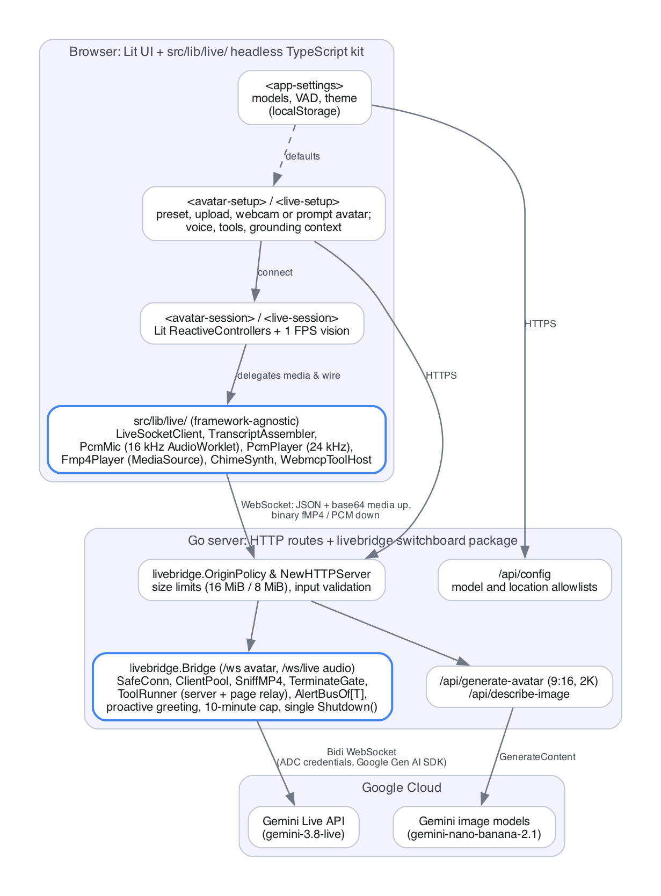

# Developer Guide: Architecture & Design

Why Gemini Live Studio is structured around a **Switchboard Proxy**, what hard-won
Gemini Live API sharp edges the **`livebridge`** (Go) and **`src/lib/live/`**
(TypeScript) kit solves automatically, and how the two reference applications
specialize those shared building blocks.

> **Diataxis navigation**
>
> - **Tutorials (Learning):** [Quickstart](../README.md#quickstart) and [User Guide](user_guide.md)
> - **How-To Guides (Recipes):** [Building Voice & Avatar Agents](building-with-livebridge.md)
> - **Explanation (Understanding):** You are here
> - **Reference (Specifications & APIs):** [Live Wire Protocol & Kit Reference](live-wire-protocol.md) and [Frontend Components](frontend-components.md)

## Contents

- [Why a voice-agent kit](#why-a-voice-agent-kit)
- [Switchboard architecture](#switchboard-architecture)
- [Sharp edges solved by the kit](#sharp-edges-solved-by-the-kit)
- [How the two reference applications use the kit](#how-the-two-reference-applications-use-the-kit)
- [Model configuration quirks](#model-configuration-quirks)
- [UI conventions](#ui-conventions)
- [Verifying model capabilities](#verifying-model-capabilities)

## Why a voice-agent kit

Connecting a browser microphone to the Gemini Live API looks straightforward on
paper: open a WebSocket, stream audio up, play audio back. In practice, every
production voice or avatar application runs into the same ~1,500 lines of
concurrency, media-pipeline, and wire-protocol hazards:

- **Credential exposure:** Direct browser connections leak API keys or OAuth
  tokens to the client.
- **Orphaned upstream sessions:** The Go `genai` SDK's `Live.Connect` ignores
  `context.Context` cancellation once connected, leaving upstream sessions open
  unless explicitly closed on every error path.
- **Goroutine write panics:** `gorilla/websocket` panics if the upstream receive
  loop, an async tool worker, a background alert watcher, and a session-cap
  timer write to the browser socket concurrently.
- **Barge-in media desync:** When a user interrupts the assistant mid-sentence,
  queued Web Audio buffers or Media Source Extensions (`MediaSource`) video
  ranges keep talking unless aborted and trimmed immediately.
- **Farewell turn races:** Asking the model to say goodbye while interrupting an
  active turn produces _two_ `TurnComplete` signals ~140 ms apart; naive handlers
  hang up on the first one and cut off the farewell.
- **Asymmetric transcripts:** Input speech transcripts arrive as accumulated
  full strings (replace), whereas model output transcripts arrive as incremental
  deltas (append).
- **Codec and modality traps:** Video codec profiles vary across Live model
  revisions (`avc1.42C020` vs `avc1.42E01E`), and sending JPEG vision frames
  through the legacy `Media` field fails with WebSocket close code `1007`.

Rather than re-solving those problems in every project, this repository extracts
them into two small, framework-agnostic layers:

1. **[`livebridge/`](../livebridge/) (Go):** Owns HTTP origin policy, per-region
   `genai.Client` caching, mutex-serialized WebSocket framing, fMP4 codec
   sniffing, proactive greetings, `TerminateGate` farewells, asynchronous
   server-side and browser-relayed tool execution with barge-in cancellation,
   and untrusted background alert fan-out.
2. **[`frontend/src/lib/live/`](../frontend/src/lib/live/) (TypeScript):** Pure
   browser modules (zero Lit or React dependency) for 16 kHz `AudioWorklet`
   microphone capture, 24 kHz gapless PCM playback with Audio-Reactive Mute,
   fragmented MP4 `MediaSource` playback with inter-turn gap recovery,
   procedural Web Audio notification chimes, immutable transcript assembly,
   WebSocket close diagnostics, and WebMCP (`document.modelContext`) tool
   hosting.

Application code shrinks to declaring a persona, registering tools, and binding
state to your UI framework of choice.

## Switchboard architecture

Every Gemini Live session runs through a backend **Switchboard Proxy** (a
backend-for-frontend) rather than dialing the Gemini Live API from the browser.



```text
Browser (src/lib/live/) ──WS /ws       (JSON control + base64 media up, binary fMP4 down)──▶ livebridge.Bridge (Go)
Browser (src/lib/live/) ──WS /ws/live  (JSON control + base64 media up, binary PCM down)───▶ livebridge.Bridge (Go)
livebridge.Bridge (Go)  ──wss BidiGenerateContent (Google Gen AI SDK, ADC bearer token)────▶ Gemini Live API
```

### Why a backend switchboard is essential

1. **Zero credentials in the browser:** The Go server authenticates to Google
   Cloud with Application Default Credentials (`ClientPool`). Browser clients
   never receive bearer tokens or API keys.
2. **Server-enforced policy:** `OriginPolicy` blocks cross-site WebSocket
   hijacking (`403 Forbidden`), `ResolveAllowed` restricts models and locations
   to server allowlists, and `SetReadLimit` caps setup frames at `16 MiB` and
   runtime frames at `8 MiB` before data reaches Google Cloud.
3. **Asymmetric framing for efficiency:** Browser-to-server frames are UTF-8
   JSON text (carrying control events and small base64 16 kHz PCM or 1 FPS JPEG
   chunks). Server-to-browser media flows down as **raw binary WebSocket frames**
   once a single `media_config` JSON message announces the PCM sample rate or
   sniffed fMP4 codecs—avoiding 33% base64 overhead on high-bitrate video.

> **Upstream wire gotcha:** When working directly against the Gemini Live Bidi
> WebSocket, every `serverContent` message—including JSON metadata like
> `turnComplete` and `interrupted`—arrives inside a **binary**-typed frame.
> `google.golang.org/genai` unmarshals this inside `Session.Receive()`, and
> `livebridge.Bridge` splits media and control cleanly for the browser.

### Separation between headless core and UI

On the frontend, [`frontend/src/lib/live/`](../frontend/src/lib/live/) holds all
stateful browser APIs (`AudioContext`, `AudioWorkletNode`, `MediaSource`,
`SourceBuffer`, `WebSocket`, `document.modelContext`) behind plain callback and
`EventTarget` interfaces. In Gemini Live Studio, thin Lit `ReactiveController`
adapters in [`frontend/src/controllers/`](../frontend/src/controllers/) wrap
those classes and call `host.requestUpdate()`. A React, Vue, Svelte, or vanilla
TypeScript app can import `src/lib/live/` directly without pulling in Lit.

## Sharp edges solved by the kit

### 1. Deterministic dual-socket teardown (`Bridge.Shutdown`)

`genai`'s `Live.Connect` uses its `context.Context` only during the dial
handshake; canceling `ctx` afterward closes **nothing**. Every session exit
path—the `9m55s` session cap, the `12s` goodbye backstop, the goodbye turn's
`TurnComplete`, an upstream disconnect, an upstream send error, a browser write
error, or a browser tab close—funnels through `Bridge.Shutdown()`, guarded by
`sync.Once`:

1. Cancels the session context and stops session-cap and goodbye timers.
2. Cancels all in-flight tool contexts and waits for tool goroutines (`ToolRunner`).
3. Closes the upstream `genai.Session`.
4. Sends an RFC 6455 close control frame (with a 1-second write deadline via
   `SafeConn.WriteClose`) and closes the browser TCP socket.

### 2. Race-free farewell turns (`TerminateGate`)

Closing cleanly when a user clicks **End Session** is subtler than checking
`TurnComplete && !Interrupted` on a single message:

- **The race:** If the assistant is speaking when the farewell prompt is
  injected, the Live API emits `Interrupted` and `TurnComplete` as **two
  separate messages** roughly 140–150 ms apart, followed later by a second
  `TurnComplete` for the farewell itself. Checking both flags on one message
  always fires on the aborted turn's wrap-up, cutting off the goodbye before a
  single syllable plays.
- **The fix:** `TerminateGate` uses two atomic booleans (`terminating` and
  `pendingInterrupt`). When `Interrupted` arrives during termination, it sets
  `pendingInterrupt`. The first `TurnComplete` clears `pendingInterrupt` via
  compare-and-swap and is ignored; only the farewell turn's own `TurnComplete`
  closes the session. Server (`12s`) and client (`15s`) backstop timers are
  ordered so the server always wins cleanly if a network drop swallows
  `TurnComplete`.

### 3. Proactive greetings on `SetupComplete`

Waiting for the user to speak first makes a voice interface feel dead. As soon
as upstream `SetupComplete` arrives, `Bridge` injects `GreetingPrompt` via
`SendRealtimeInput` so the assistant speaks first, and only then opens the gate
for queued background alerts so an alert never collides with setup.

### 4. Asymmetric streaming transcripts (`TranscriptAssembler`)

Gemini Live's two speech-recognition streams have opposite semantics:

- **`input_transcript` (user speech):** Streams the _accumulated_ utterance so
  far—each partial **replaces** the active user bubble until `finished: true`.
- **`output_transcript` (model speech):** Streams incremental _deltas_
  (`"Hello"`, `" there!"`)—each partial **concatenates** onto the active
  assistant bubble until `finished: true`.

Never filter transcripts on `Finished == true` on the server; doing so drops
~99% of real-time chunks and breaks live captioning. `Bridge` relays every
partial with a JSON boolean `finished`, and `TranscriptAssembler` handles
overwrite-vs-append immutably, including `[Interrupted]` markers on barge-in.

### 5. Off-thread audio, Audio-Reactive Mute, and fMP4 MSE recovery

- **16 kHz `AudioWorklet` capture (`PcmMic`):** Deprecated `ScriptProcessorNode`
  runs on the UI thread and causes audible glitches under DOM load. `PcmMic`
  registers an inline `AudioWorkletProcessor` from a Blob URL, accumulating
  2048-sample Int16 frames (~128 ms at 16 kHz) off-thread with a `startToken`
  guard that prevents microphone track leaks across rapid start/stop clicks.
- **Audio-Reactive Mute (`PcmPlayer`):** Routes
  `AudioBufferSourceNode -> AnalyserNode -> GainNode -> destination`. Muting
  sets `GainNode.gain.value = 0` _after_ the `AnalyserNode`, so voice
  visualizers keep animating while speaker output is silent.
- **Dynamic fMP4 codec sniffing (`SniffMP4`):** Avatar streams emit different
  H.264 profiles across model versions (such as `avc1.42C020` Baseline Level 3.2
  vs `avc1.42E01E` Level 3.0). `SniffMP4` parses `ftyp` and `avcC` boxes from
  the first video fragment and announces exact codecs in `media_config`.
- **Inter-turn MSE gap jumping & barge-in trimming (`Fmp4Player`):** Because the
  Live API sends video fragments only while the avatar speaks, browser MSE
  demuxers stall (`HAVE_NOTHING`) across silent gaps between turns. On
  `SourceBuffer.updateend`, `Fmp4Player` advances `video.currentTime` across
  discontinuities to the latest buffered range, evicts old ranges on
  `QuotaExceededError`, and on `interrupted` aborts pending appends and removes
  future buffered audio/video so the avatar stops speaking immediately.

### 6. Non-blocking tools, visual results, and WebMCP coalescing

Blocking `Session.Receive()` while a slow tool runs freezes audio/video output
and prevents barge-in. `ToolRunner` executes every `FunctionCall` on its own
goroutine with a per-call `context.Context` keyed by `FunctionCall.ID`:

- **Server-side tools (`FuncRegistry`):** Run in Go; if `ToolCallCancellation`
  arrives when the user interrupts, `ToolRunner` invokes each matching
  `CancelFunc` and discards late responses.
- **Browser / WebMCP page tools (`AllowPageRelay` + `WebmcpToolHost`):** Forward
  unregistered calls to the browser over WebSocket (`tool_call`) and await
  `tool_result`. `WebmcpToolHost` registers tools with `document.modelContext`
  when Chrome's WebMCP API is active (falling back transparently in other
  browsers), verifies tool ownership against cross-script poisoning, and
  coalesces back-to-back duplicate interactive calls (`coalesceInFlight: true`).
- **Visual tool results before `FunctionResponse` (`SeeVisualResults`):** When a
  browser tool produces or edits a visual artifact (such as a canvas or image),
  returning an `image` data URL instructs `ToolRunner` to send that snapshot via
  `SendRealtimeInput({Video: ...})` _immediately before_ `SendToolResponse`, so
  the model can see the visual outcome while composing its spoken explanation.

### 7. Untrusted background alerts (`AlertBusOf[T]`)

Voice consoles often watch external systems (CI builds, cluster streams, task
queues) and ask the assistant to announce important events. `AlertBusOf[T]`
provides non-blocking multi-tab fan-out with a bounded pre-session backlog (held
until `SetupComplete`), and `FormatUntrustedAlert` wraps external alert text in
explicit untrusted-data delimiters so prompt-injection payloads inside logs or
commit messages are summarized as data rather than obeyed as instructions.

## How the two reference applications use the kit

This repository ships two complete reference applications built on the exact
same `livebridge` Go package:

| Dimension               | **Gemini Live Studio** ([root app](../README.md))                                                               | **Local Code Assistant** ([`examples/local-code-assistant/`](../examples/local-code-assistant/))           |
| :---------------------- | :-------------------------------------------------------------------------------------------------------------- | :--------------------------------------------------------------------------------------------------------- |
| **Primary goal**        | Full-featured multimodal studio for custom talking avatars and live audio/vision                                | Standalone voice coding agent that explores a local repository and draws architecture diagrams             |
| **Session setup**       | Dynamic `InitialConfig` first WebSocket frame (`16 MiB` limit for custom 2K `9:16` avatars, persona, grounding) | Fixed server persona + optional `model` query parameter; streams runtime audio/text immediately on connect |
| **Endpoints & modes**   | `/ws` (`ModeAvatar`, binary fMP4) and `/ws/live` (`ModeAudio`, binary 24 kHz PCM + 1 FPS camera/screen vision)  | `/ws` supporting audio-only, Web Audio reactive orb, or `ModeAvatar` fMP4 video via environment flags      |
| **Audio wire delivery** | `AudioDeliveryBinary` (`media_config` + raw PCM binary frames)                                                  | `AudioDeliveryBase64JSON` in audio/orb modes; binary fMP4 with `SniffMP4` in video avatar mode             |
| **Tooling pattern**     | Google Search grounding + server-side `show_info_card` rendered inline in the transcript via `ToolRunner`       | Server-side `FuncRegistry` (`list_directory`, `read_file`, `generate_diagram`) + `GoogleSearch`            |
| **Frontend stack**      | Multi-view Lit + Vite design system (`src/controllers/` wrapping `src/lib/live/`)                               | Zero-build embedded single-file `index.html` with dual-channel `tool_execution` code and diagram cards     |
| **Module & packaging**  | Root Go module (`gemini-live-studio`) importing `./livebridge` directly; Cloud Run `Dockerfile`                 | Standalone Go module syncing `internal/livebridge` via `make sync-livebridge`; portable `.skill` archive   |

### Why `examples/local-code-assistant` syncs `internal/livebridge`

`examples/local-code-assistant` has its own `go.mod` so developers can copy the
directory out of this repository—or bundle it with `make pack-skill`—and run
`go build` with zero parent-directory dependencies. Rather than adding a brittle
`replace` directive pointing to `../..`, `make sync-livebridge` copies
`livebridge/*.go` into `examples/local-code-assistant/internal/livebridge/`
(rewriting only `package livebridge` imports), and `make lint` enforces zero
drift with `diff -qr`.

For step-by-step code recipes covering every pattern above, continue to
**[Building Voice & Avatar Agents](building-with-livebridge.md)**.

## Model configuration quirks

These constraints are verified directly against the Gemini Live API on Google Cloud:

- **`AvatarConfig` is mandatory for `VIDEO`:** 3.x Live models require
  `AvatarConfig` whenever `ResponseModalities: ["VIDEO"]` is requested.
- **`AUDIO` + `VIDEO` together is rejected (`1007`):** Requesting both
  modalities fails with
  `combination of response modalities (AUDIO, VIDEO) is not supported`. Request
  `VIDEO` alone—synthesized speech arrives muxed inside the fMP4 container.
- **Realtime vision must use `{Video:}`, never `{Media:}`:** In the Go SDK,
  `LiveSendRealtimeInputParameters{Media:}` serializes to the legacy
  `mediaChunks` wire field and fails with
  `1007: Mime type 'image/jpeg' is not supported`. Always populate
  `Video: &genai.Blob{MIMEType: "image/jpeg", ...}`.
- **Proactivity is model-dependent:** `gemini-3.8-live` and `lite` Live models
  support `ProactivityConfig.ProactiveAudio`; `gemini-3.5-flash-live-preview`
  rejects it with `1007`. Use `livebridge.SupportsProactiveAudio(model, fallback)`
  to gate `ProactivityConfig` safely.
- **`EnableAffectiveDialog` and `SessionResumption`:** `enable_affective_dialog`
  is rejected on Vertex Bidi (`1007 Unknown name`), and `SessionResumption` does
  not currently emit `NewHandle` tokens. Extend long conversations with
  `ContextWindowCompression` (`SlidingWindow` + `TriggerTokens`) instead.
- **Custom avatar reference images:** `gemini-3.8-live` validates custom avatar
  dimensions at setup (`704x1280` minimum portrait; landscape normalized to
  `1280x704`; `1024x1024` square rejected with `1007`). Always encode anchors as
  **PNG or JPEG**, never WebP (`1011 internal error`).
- **Safety-filter checks happen after `setupComplete`:** Blocked reference
  images close with `1008 policy violation` when animation begins, so smoke
  tests must await the first media chunk rather than stopping at `setupComplete`.

## UI conventions

Gemini Live Studio's UI follows **[Frontend Components](frontend-components.md)**
with the design north star **"Clear, Approachable Intelligence"**:

- **Surface hierarchy over borders:** Separate regions using background tokens
  (`surface-container-low` vs `surface-container-highest`) rather than 1px lines.
- **Responsive session layout:** Desktop pairs the video/audio stage with a side
  transcript drawer; mobile collapses to a stage-first layout with a tab
  switcher.
- **Light DOM + design tokens:** Lit components render into Light DOM so
  build-time Tailwind utilities and `src/theme/tokens.ts` light/dark CSS custom
  properties apply uniformly without Shadow DOM style duplication.

## Verifying model capabilities

Preview and GA Live models evolve independently of SDK struct fields—an exported
field in `google.golang.org/genai` does not guarantee the service accepts it.
When evaluating a new `GEMINI_LIVE_MODEL` or `GEMINI_IMAGE_MODEL`:

1. Add the candidate ID to `models.go` and configure `.env`.
2. Verify both `/ws` (avatar video) and `/ws/live` (audio + vision): confirm
   `setupComplete`, the first decoded video fragment or PCM chunk, streaming
   input/output transcripts, barge-in buffer flushing, and clean **End Session**
   farewell teardown.
3. Re-test model-sensitive options (`ProactivityConfig`, `ContextWindowCompression`,
   and custom `9:16` avatar anchors) end-to-end.
