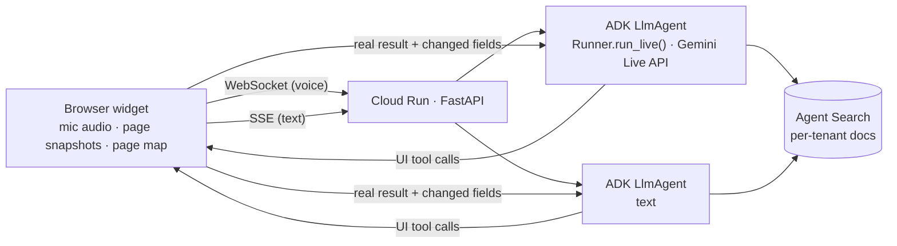

# Wayfinder: real-time agents that operate your web app with the Gemini Live API and ADK

|           |             |
| --------- | ----------- |
| Author(s) | KC Ayyagari |

> **Disclaimer:** This is not an officially supported Google product. It is a sample for learning and experimentation.

Wayfinder is a voice and text assistant that you embed in a web app with a single `<script>` tag. Users say what they want ("set up a production web server…"), and an agent built with the [Agent Development Kit (ADK)](https://google.github.io/adk-docs/) on the [Gemini Live API](https://docs.cloud.google.com/gemini-enterprise-agent-platform/models/live-api) completes the task **in the page itself**: it fills in fields, picks options, flips toggles, and moves between sections while the conversation continues. "How do I…?" questions are answered from your own documentation through [Agent Search](https://cloud.google.com/enterprise-search).

Instead of reading pixels, the agent works from the page's own structure (the DOM). It targets exact controls, runs in the user's own signed-in session, can only use the tools you expose, and gets the real result back after every action.

## What's in this sample

| Demo                                  | Route    | What to try                                                                                                                                  |
| ------------------------------------- | -------- | -------------------------------------------------------------------------------------------------------------------------------------------- |
| **Persona picker**                    | `/`      | Choose a persona; sample prompts open the app with the prompt pre-filled                                                                     |
| **ACME Cloud console** (fictional)    | `/cloud` | _"Set up a production web server: name it web-prod, region US East, the Standard S4 plan, allow HTTP and HTTPS, and turn on verified boot."_ |
| **ACME People HR portal** (fictional) | `/hr`    | _"Enroll me in the PPO medical plan with dental and vision, set my 401(k) to 10%, and save."_                                                |

ACME Cloud and ACME People are fictional apps created for this sample.

## How it works



1. **Page map.** The widget scans the page for interactive controls: selector, label, current value, and options, including controls in hidden tabs (up to 120). The agent is instructed to act only on controls from this list.
2. **Page snapshots (voice).** While the mic is on, the widget sends a low-resolution snapshot of the page every ~3 seconds and after each action, rendered with [html2canvas](widget/third_party/html2canvas).
3. **UI actions are ADK tools.** `click_element`, `type_text`, `select_option`, `highlight_element`, and `scroll_to_element` are plain async Python functions. In both voice and text mode each call is sent to the browser, which performs it and reports the real outcome (for example `{"success": false, "error": "Option 'eu-north' not available.", "options": [...]}`) plus the fields that changed. The agent plans, acts, observes, and corrects itself.
4. **Grounding.** A `search_knowledge_base` tool queries a Agent Search engine per tenant and returns a summary with citations. In voice mode it runs as a `NON_BLOCKING` tool, so the agent keeps talking while it searches.
5. **Models.** Voice uses **Gemini 3.8 Live** (GA) and typed chat uses **Gemini 3.8 Flash** (GA). Both run in the `us` multi-region on Gemini Enterprise Agent Platform. To try **Gemini 3.8 Live Extended Thinking** for multi-step requests, set `GEMINI_MODEL` to its model ID in a project with access. The voice agent switches to async tools and a thinking level automatically, and falls back to Gemini 3.8 Live if the session can't start.
6. **Natural voice.** Users can interrupt the agent (barge-in). The agent session uses proactive audio, context window compression, and session resumption, which are configured through ADK's `RunConfig`. If the model rejects an optional feature, the session retries once without it.

The text transport (`POST /v1/chat/stream` + `POST /v1/chat/tool_result`) uses the same browser-backed UI tools on an ADK text agent and streams events as Server-Sent Events.

## Quickstart

**Prerequisites:** Python 3.10+, the [gcloud CLI](https://cloud.google.com/sdk/docs/install), and a Google Cloud project with the Agent Platform API enabled (and the Discovery Engine API if you use grounding).

```bash
gcloud auth application-default login
cp .env.example .env          # set GOOGLE_CLOUD_PROJECT (GOOGLE_CLOUD_LOCATION defaults to us)
make install
make run                      # http://localhost:8080
```

Open `http://localhost:8080`, pick a persona, and click **Ask Wayfinder** (bottom right). Type, or tap the mic to talk. The mic needs `localhost` or HTTPS.

Run the tests with `make test`.

## Ground answers in your docs (optional)

Without grounding, actions work and questions are answered from the page and the model's general knowledge. To answer from documentation:

```bash
make demo-docs                # renders demo/*-docs/*.html to PDF
# Upload the PDFs and create a Agent Search engine (prints a .env entry):
gcloud storage cp demo/acme-cloud-docs/*.pdf gs://YOUR_BUCKET/acme-cloud/
.venv/bin/python scripts/provision_docs.py --project YOUR_PROJECT \
    --tenant acme-cloud-docs --origin acme-cloud --gcs-uri gs://YOUR_BUCKET/acme-cloud/
```

Add the printed `VERTEX_SEARCH_ENGINES` entry to `.env` and restart. The key (`acme-cloud`) matches the widget's `data-tenant`. To index a documentation site instead of files, use `scripts/provision_engine.py`; it requires domain verification in Search Console.

## Add Wayfinder to your own app

```html
<script
  src="https://YOUR-SERVICE/wayfinder.js"
  data-key="wf_..."
  data-tenant="my-app"></script>
```

| Attribute               | Purpose                                              |
| ----------------------- | ---------------------------------------------------- |
| `data-key`              | API key, required when `AUTH_ENABLED=true`           |
| `data-tenant`           | Grounding key that selects the Agent Search engine   |
| `data-barge-in="false"` | Mute the mic while the agent speaks (for loud rooms) |

The agent is much more reliable when controls have stable `id` or `data-testid` attributes and real `<label>`s. Sections that use `role="tabpanel"` with matching `data-tab` / `aria-controls` tabs are opened automatically before an action.

## Configuration

| Variable                     | Default            | Description                                                                                                     |
| ---------------------------- | ------------------ | --------------------------------------------------------------------------------------------------------------- |
| `GOOGLE_CLOUD_PROJECT`       | from gcloud        | Project for Agent Platform                                                                                      |
| `GOOGLE_CLOUD_LOCATION`      | `us`               | Agent Platform location for model calls (`us` serves both default models)                                       |
| `GEMINI_MODEL`               | `gemini-3.8-live`  | Voice model (Gemini Live API). Set to the Gemini 3.8 Live Extended Thinking model ID if your project has access |
| `GEMINI_FALLBACK_MODEL`      | `gemini-3.8-live`  | Voice model used automatically if `GEMINI_MODEL` can't start                                                    |
| `GEMINI_TEXT_MODEL`          | `gemini-3.8-flash` | Text model                                                                                                      |
| `LIVE_THINKING_LEVEL`        | `MEDIUM`           | Reasoning level (`LOW`, `MEDIUM`, `HIGH`), used only with Extended Thinking                                     |
| `LIVE_VOICE`                 | `Aoede`            | Prebuilt output voice                                                                                           |
| `LIVE_PROACTIVE_AUDIO`       | `true`             | Ignore speech not addressed to the agent                                                                        |
| `LIVE_AFFECTIVE_DIALOG`      | `false`            | Adapt tone to the user's emotion                                                                                |
| `LIVE_CONTEXT_COMPRESSION`   | `true`             | Sliding-window compression for long sessions                                                                    |
| `LIVE_ASYNC_SEARCH`          | `true`             | Knowledge search as a non-blocking tool                                                                         |
| `VERTEX_SEARCH_ENGINES`      | `{}`               | JSON map of grounding key to engine path                                                                        |
| `ALLOWED_ORIGINS`            | `*`                | CORS allowlist of full origins                                                                                  |
| `AUTH_ENABLED`               | `false`            | Require an API key and an allowed `Origin`                                                                      |
| `API_KEYS` / `API_KEYS_FILE` | —                  | `{"wf_key": {"name": "Acme", "origins": ["acme.com"]}}`                                                         |
| `SELF_ORIGIN`                | —                  | Service hostname; co-hosted pages skip the key check                                                            |

## Deploy to Cloud Run

```bash
make deploy                   # wraps ./deploy.sh
```

`deploy.sh` turns `AUTH_ENABLED` on by default. The demo pages served by the same service keep working through `SELF_ORIGIN`; other sites need an entry in `API_KEYS`. Set `API_KEYS_SECRET=<secret-name>` to mount keys from Secret Manager. The Cloud Run region comes from `REGION` (default `us-central1`) and is separate from `GOOGLE_CLOUD_LOCATION` (default `us`), the Agent Platform location used for model calls.

## Safety and limitations

- **Origin and sessions.** Access checks use the browser's `Origin` header, not a value the page sends. Chat session IDs are issued by the server and bound to the site and tenant.
- **Untrusted page data.** Labels and values from the page are shortened, stripped of formatting, and marked as data the model must not follow as instructions.
- **Human in the loop.** The agent is _instructed_ not to click irreversible buttons (Create, Delete, Submit, Run, Pay, Save, Launch) unless the user asks, and "show me where" requests only highlight. These are prompt-level rules, not enforced policies. For production, add server-side checks for the actions your app considers sensitive.
- **Sessions** are stored in memory (`InMemorySessionService`), so use a persistent session service for multi-instance deployments.
- **Snapshots** are rendered from the DOM by html2canvas and may miss cross-origin images or canvas content.

## Project layout

```text
backend/
  server.py              FastAPI app: pages, /v1/chat/stream + /v1/chat/tool_result (text), /ws (voice)
  browser_tools.py       Shared UI tools and browser round-trip bridge (voice + text)
  voice_agent.py         ADK live agent and RunConfig
  agents/text_agent.py   ADK text agent
  page_map.py            Element list formatting and sanitization
  system_instruction.py  Voice agent instructions
  rag/                   Agent Search pipeline and coordinator
  gateway/policy.py      API key + origin policy
widget/wayfinder.js      Embeddable widget (Shadow DOM, mic, snapshots, DOM actions)
demo/                    Persona picker, ACME Cloud and ACME People demos, grounding docs
scripts/                 Agent Search provisioning and doc rendering
tests/                   Unit tests (no network)
```

## License

Apache 2.0; see [LICENSE](../../../LICENSE). html2canvas is MIT licensed; see [widget/third_party/html2canvas/LICENSE](widget/third_party/html2canvas/LICENSE).
