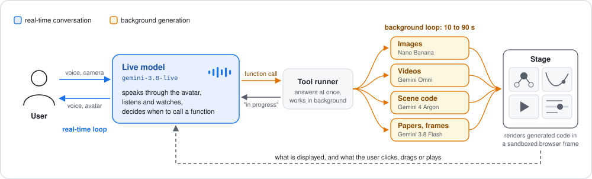
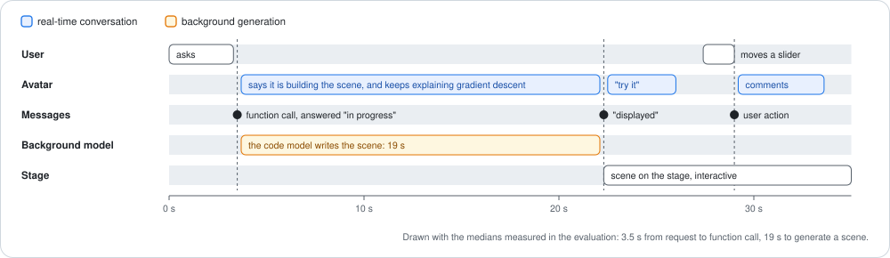

# VoxPlore: Voice-Driven Multimodal Interaction for Learning and Research

Author: [Wafae Bakkali](https://github.com/WafaeBakkali)

VoxPlore is an interactive system for exploring a subject by talking, whether a concept to learn, a place to discover or a research paper to understand. It brings the generation of images, video and interactive scenes into a live spoken conversation, driven by voice. While a live model talks with the user through an avatar, background models generate images and videos and write the code of interactive 3D scenes and simulations, which run on a stage beside the conversation. The conversation never pauses for the generation, and the system observes how the user operates what was generated and feeds it back into the conversation.

## Contributions

- An asynchronous multi-model architecture. A live model holds the conversation in real time (Gemini Live API), while specialist models generate in the background: Nano Banana for images, Gemini Omni for video, Gemini 4 Argon for scene code, Gemini Flash for camera frames and documents. Function calls are answered at once and completed asynchronously, so speech and generation overlap.
- Generated code as a medium. Interactive scenes are written as code on request and executed in a browser sandbox, with one automatic repair when a scene fails. For subjects that have to be drawn, an image is generated and its parts are detected and made selectable.
- A closed interaction loop. Generated scenes are instrumented: the user's selections, parameter changes and outcomes are reported to the live model, which responds to them.
- Grounding in research papers. A paper loaded from a PDF, a link or Google Search can be questioned, its figures displayed, and a figure, an equation or a method converted into an interactive scene shown beside its source page.
- An evaluation harness. A request set and a script that measure tool routing, the reliability of generated scenes, the factual accuracy of generated images against generated code, and latency.

Two application modes are built on the system: a general-purpose tutor (learning mode) and a paper assistant with reviewer-style questioning (research mode). An optional proactive mode lets the system decide when a visual is warranted, without an explicit request.

<p align="center">
  
</p>

The system has two loops: a real-time loop for the conversation, in blue, and a background loop for generation, in amber.

## Capabilities

- Real-time spoken dialogue with an avatar, with camera and screen input.
- Image and video generation and editing during the conversation, without blocking it.
- Interactive scenes generated as code: 3D models with selectable parts, and 2D simulations with sliders and buttons, executed in a browser sandbox.
- Illustrated scenes for subjects that have to be drawn, such as anatomy, a cell or a city: a generated image with detected, selectable parts and a quiz.
- Interaction feedback: the agent receives the user's selections, parameter changes and outcomes in a scene, and responds to them.
- Visual markup of the camera view, for example to locate a mistake in handwritten work.
- Paper grounding: loading from a PDF, a link or Google Search, question answering, display of figures as printed, scenes built from a figure, an equation or the method with the source page alongside, and reviewer questions for pitch practice.
- Multi-image references for image and video generation.
- Proactive generation: the agent creates an image or a scene on its own initiative when it supports an explanation.
- An evaluation harness for tool routing, scene reliability, factual accuracy of images against code scenes, and latency.

## How it works

### Two loops

- One live model holds the conversation. It listens, speaks through the avatar and decides when to call a function. It never waits for a generation.
- Background models make what is shown: images, videos, the code of a scene, and the reading of camera frames and papers.
- A small server (`server.py`) connects them. It relays audio and video between the browser and the Live API, and runs the function calls.

### Function calling

Everything the avatar creates goes through function calling. The agent is an ADK `LlmAgent`, and its instruction and twelve function declarations are sent to the Live API in the setup message.

1. The live model sends a `toolCall`, for example `generate_interactive_scene`.
2. The server replies at once with a `toolResponse` of `in_progress`. The avatar keeps talking.
3. The function runs as a background task and calls a generation model.
4. The result goes to the stage as `generatedMedia`, and the live model is told, as realtime text, that it is displayed. The avatar is instructed not to announce a result before that.
5. What the user then does in a scene comes back as `sceneEvent` messages, which the server relays to the live model as text.

Because the call is answered at once, the conversation never waits. This is one request over time:

<p align="center">
  
</p>

### Rendering

- Images and videos are shown as they come back from the models.
- A code scene is JavaScript written by the scene model against a small runtime (`frontend/scene/stage.js`), which provides the 3D view, plots, sliders, buttons and clickable parts. The browser renders it in a frame with `sandbox="allow-scripts"`, so generated code cannot reach the app, its storage or its cookies. Nothing generated runs on the server.
- If a scene fails to run, the browser reports the error and the scene model gets one attempt to fix it.
- An illustrated scene is an image from the image model, with part names, positions and explanations from the reader model, shown by a fixed page (`voxplore/illustrated_scene.html`).

More detail, the evaluation method and the limits are in [docs/technical_note.md](docs/technical_note.md).

## Modes

Two controls sit under the avatar. Both can be changed during a session.

- Mode: Learning or Research. Learning addresses a general learner and opens on general subjects. Research addresses a researcher and opens on loading a paper. The paper features are available in both.
- Proactive: off or on. When on, the avatar also creates an image, a code scene or an illustrated scene on its own while it explains, one at a time, and says that it is doing so. It is experimental and off by default.

`DEMO_PRESET` and `PROACTIVE_MODE` in `.env` set their starting values.

## Quick start

You need Python 3.10 or later, Chrome, and a Google Cloud project with the Agent Platform API enabled (Gemini Enterprise Agent Platform, formerly Vertex AI) and access to the models listed below.

```shell
python -m pip install -r requirements.txt
python fetch_three.py
gcloud auth application-default login
```

`fetch_three.py` downloads three.js, which the generated scenes import, into `frontend/vendor/`. Copy `.env.example` to `.env`, and set `GCP_PROJECT_ID`, `GCP_REGION` and the host in `GEMINI_LIVE_API_URL`. Then:

```shell
python server.py
```

Open <http://localhost:8080>, click Connect and allow the microphone.

## Examples to try

| Mode | You say | You get |
| --- | --- | --- |
| Learning | "Show me a water molecule in 3D." | A 3D scene written as code. Rotate it, click an atom, and the avatar comments. |
| Learning | "Let me play with gradient descent." | A simulation with sliders and buttons. |
| Learning | "Let me explore the human body." | A drawn illustration with clickable parts and a quiz. |
| Learning | "Draw a diagram of a neural network." Then "animate it." | An image, then a video made from it. |
| Learning | "Can you check my work?" with the camera on | Your own picture, with the mistake marked. |
| Research | "Make an interactive simulation of this paper." | A question about what you want to explore, then a scene built from the paper. |
| Research | "Show me figure 3." | The figure as printed in the paper. |
| Research | "Question me like a reviewer." | Questions on your paper, one at a time, then feedback. |
| Proactive on | "Explain how attention works in a transformer." | An explanation, and an image or a scene the avatar decides to make. |

You can also upload several images and use them as references ("combine image 1 and image 2").

## Models

| Role | Default | Setting |
| --- | --- | --- |
| Voice, avatar, function calls | `gemini-3.8-live` | `voxplore/agent.py` |
| Images | `gemini-nano-banana-2.1` | `IMAGE_MODEL` |
| Videos | `gemini-omni-1.2-flash` | `VIDEO_MODEL` |
| Scene code | `gemini-4-argon` | `SCENE_MODEL` |
| Reading frames and illustrations | `gemini-3.8-flash` | `READER_MODEL` |
| Reading papers | `gemini-3.8-flash` | `PAPER_MODEL` |

## Settings

All settings are in `.env`. The ones you are most likely to change:

| Setting | Meaning |
| --- | --- |
| `GCP_PROJECT_ID`, `GCP_REGION`, `GEMINI_LIVE_API_URL` | Project and location of the Live API |
| `ENABLE_AVATAR`, `AVATAR_NAME`, `VOICE_NAME` | Avatar and voice. Both can also be changed in the app |
| `IMAGE_MODEL`, `VIDEO_MODEL`, `SCENE_MODEL`, `READER_MODEL`, `PAPER_MODEL` | Models, each with a matching `_LOCATION` |
| `SCENE_MODE` | `template`: the model writes only the scene-specific code, which is faster. `free`: it writes the whole page |
| `SCENE_THINKING_LEVEL` | Optional, `low` or `high`. Less reasoning means a scene comes back sooner |
| `SCENE_LIBRARY` | `off` by default: every scene is generated. `on` uses scenes prepared with `prewarm_scenes.py` when one matches |
| `DEMO_PRESET` | Starting mode: `learning` or `research` |
| `PROACTIVE_MODE` | Starting state of the Proactive switch: `off` or `on` |
| `APP_NAME` | Overrides the name shown in the header and the browser tab. The default is `DEFAULT_APP_NAME` in `voxplore/agent.py` |

## Tools

These are the functions the live model can call.

| Tool | What it does |
| --- | --- |
| `generate_image`, `edit_image` | Image generation and editing, optionally from the camera view or uploaded images |
| `generate_video`, `edit_video` | Video generation and editing, optionally from the last image, the camera view or uploaded images |
| `generate_interactive_scene`, `edit_interactive_scene` | A 3D or 2D scene written as code, optionally from the camera view or the loaded paper |
| `generate_illustrated_scene` | A generated image with clickable parts and a quiz |
| `annotate_current_view` | Reads what the camera shows and marks mistakes on it |
| `find_paper` | Finds a paper with Google Search and loads it |
| `ask_paper` | Answers a question from the loaded paper |
| `show_paper_part` | Shows a figure, table, equation or section as it appears in the paper |
| `prepare_questions` | Prepares questions on the paper, so the avatar can play a listener or a reviewer |

## Evaluation

`eval/run_eval.py` measures the system on the requests in `eval/requests.jsonl`:

- Routing: whether the live model calls the right tool for a request, or no tool.
- Scene reliability: whether a generated scene runs in a headless browser, first time or after the one automatic fix.
- Pixels versus code: for the same request, how many checkable facts an image gets right and how many a generated scene gets right, as judged by a model.
- Markup: the tool's finding on test frames, saved for review by eye.
- Latency per medium.

```shell
python -m pip install playwright
python -m playwright install chromium
python eval/run_eval.py --limit 2     # quick pass
python eval/run_eval.py               # full run
```

Results are written to `eval/results/` and to `frontend/results.html`, which the app links from its header. See `eval/README.md` for the method.

### Results

Run of 17 November 2026, with the default models. The full report is in `eval/reference_results/report.md`.

| Measure | Result |
| --- | --- |
| Requests routed to an expected tool, or to none when none is expected | 78 of 84 (93%) |
| Generated scenes that ran first time | 22 of 24 (92%) |
| Generated scenes that needed the automatic fix | 0 of 24 |
| Generated scenes that did not render within the time limit of the headless browser | 2 of 24 |
| Checkable facts judged correct, generated image | 56 of 62 (90%) |
| Checkable facts judged correct, generated scene | 55 of 56 (98%) |
| On the 16 requests judged in both forms, image against scene | 51 of 56 against 55 of 56 |
| Markup findings matching the known mistake | 3 of 3 |
| Median time from request to function call | 3.5 s |
| Median time to generate a scene (90th percentile) | 18.8 s (28.6 s) |
| Median time to generate an image (90th percentile) | 22.9 s (31.4 s) |

When reading the numbers, keep in mind that a scene that runs without error is not necessarily correct, that the pixels versus code verdicts come from a model, not from a person, and that the comparison rests on 16 requests. The two scenes that did not render in time were not checked further. Video and illustrated scenes are not timed.

## Security and privacy

- Generated scene code runs only in the browser, in a sandboxed frame without access to the page that hosts it. Nothing generated is executed on the server.
- Papers are fetched only from arXiv, OpenReview, the NeurIPS and PMLR proceedings and the ACL Anthology. Other addresses are refused.
- Uploaded images, camera frames and papers are kept in memory for the session and are not written to disk.
- `.env` holds your project settings and must not be committed.

## Limits

- Scenes are simplified illustrations written in about 20 seconds. They are not validated models, and a scene built from a paper can misrepresent it.
- Code scenes are made of simple shapes. Organic or realistic subjects go to illustrated scenes, images or videos.
- In an illustrated scene the part positions come from a model and can be off. A drawing of a real place is not a map.
- The page and the crop shown for a figure of a paper are located by a model and can be wrong.
- A dropped Live API connection ends the session, and the loaded paper and uploads with it.
- Generation times depend on the models and the load: about 20 seconds for an image or a scene in our evaluation, up to 30 seconds, and longer for a video.

## Project layout

```text
server.py                    WebSocket proxy, static files, routing of browser messages
voxplore/
  agent.py                   ADK agent, instruction, modes, Live API setup
  tools.py                   Tool functions and session state
  toolrunner.py              Runs tool calls in the background, relays scene events, loads papers
  genmedia.py                Calls to the image, video, scene, reader and paper models
  illustrated_scene.html     Page for illustrated scenes
  models.py, auth.py         Message models and credentials
frontend/
  index.html, app.js, style.css
  scene/stage.js             Runtime shared by generated scenes
  vendor/                    three.js, downloaded by fetch_three.py
eval/                        Evaluation script, requests and test frames
docs/                        Technical note and architecture diagram
fetch_three.py               Downloads three.js into frontend/vendor/
prewarm_scenes.py            Optional: prepares scenes in advance for SCENE_LIBRARY=on
```

## License

Apache License 2.0. See [LICENSE](LICENSE).

## Third-party code

Generated scenes use three.js and two of its add-ons (OrbitControls, CSS2DRenderer), under the MIT license. They are not stored in this repository: `fetch_three.py` downloads version 0.187.0 from the npm registry into `frontend/vendor/`, checks the archive against a fixed checksum, and saves the license as `frontend/vendor/THREE_LICENSE`.
