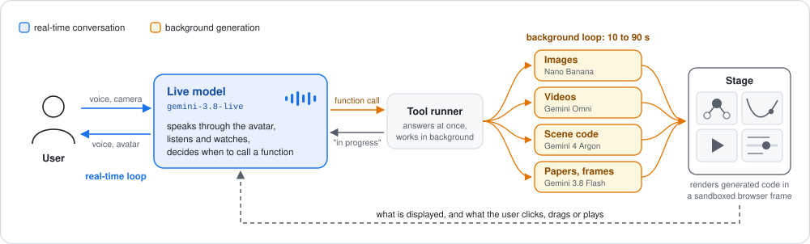
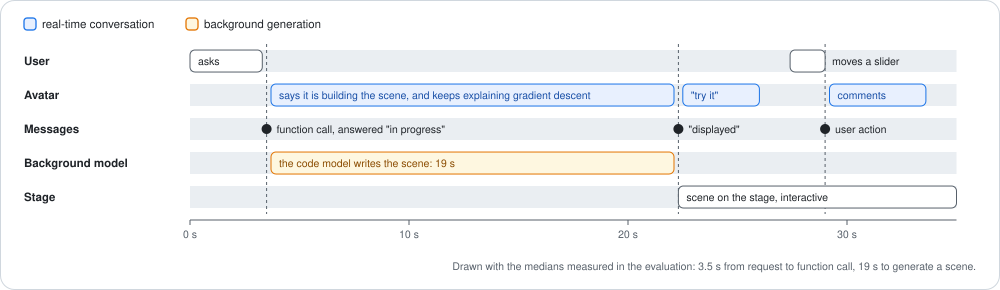

# VoxPlore: Voice-Driven Multimodal Interaction for Learning and Research

Author: [Wafae Bakkali](https://github.com/WafaeBakkali)

Design and evaluation.

## 1. Summary

VoxPlore is an interactive system for exploring a subject by talking, whether a concept to learn, a place to discover or a research paper to understand. It brings the generation of images, video and interactive scenes into a live spoken conversation, driven by voice. Its contributions are an asynchronous multi-model architecture, generated code as a medium, a closed interaction loop, grounding in research papers, and an evaluation harness. It contributes no new model. The user speaks with an avatar, driven by the Gemini Live API. When a picture, a clip or something to try would help, the agent calls a function, and a second set of models does the work in the background: Nano Banana for images, Gemini Omni for videos, Gemini 4 Argon for the code of interactive scenes, and Gemini Flash for reading camera frames and papers. The avatar keeps talking while they work. The result appears on a stage beside the conversation, and for interactive results the agent is told what the user does with them and responds.

The system has two modes. In learning mode it is a tutor for any subject. In research mode it works from a paper: it reads it, answers from it, shows its figures, builds interactive scenes from them, and questions the user as a reviewer would. An experimental proactive mode lets the agent decide on its own when to show something.

This note describes the design, how it is evaluated, and where it falls short.

## 2. The problem

Calling a generator from a voice conversation raises three problems:

- Generation takes from ten seconds to more than a minute. A spoken conversation cannot pause that long.
- A generated image looks right but cannot be operated, and its labels or geometry can be wrong. For teaching, structure and behavior matter more than appearance.
- Once something is on screen, the agent normally has no knowledge of what the user does with it.

## 3. Design

### 3.1 Two loops

The system has a real-time loop and a background loop.

- The real-time loop is one live model that holds the conversation: it listens, speaks through the avatar and decides when to call a tool. It never waits for a generation.
- The background loop is a set of specialist models that generate what is shown: an image model, a video model, a code model that writes scenes, and a document model that reads frames and papers.

A small server sits between the browser and the Live API and connects the two. In the figure, the real-time loop is in blue and the background loop in amber.

  

### 3.2 Tool calls that do not block the conversation

When the live model calls a tool, the server answers at once that the work has started and is not ready, so the model keeps speaking. The generation runs in the background. When it finishes, the server sends the result to the browser and tells the model that it is now displayed. The agent is instructed never to announce a result before that message.

The agent is an ADK `LlmAgent`. Its instruction and its twelve function declarations are sent to the Live API in the setup message. For one request, the messages are:

1. `toolCall`. The live model calls a function, for example `generate_interactive_scene`.
2. `toolResponse`. The server replies at once with the status `in_progress` and a note that the result is not ready. The avatar keeps explaining.
3. The server runs the function as a background task, which calls a generation model.
4. `generatedMedia`. The server sends the result to the browser, which shows it on the stage, and tells the live model that it is displayed. The avatar invites the user to try it.
5. `sceneEvent`. The user clicks a part or moves a slider, and the scene reports it to the server, which tells the live model. The avatar comments.

The reply in step 2 closes the function call, so nothing more can be attached to it. What happens afterwards, the result being displayed in step 4 and the user's actions in step 5, reaches the live model as a short text message (`realtimeInput.text`), as if it had been typed into the conversation. The model reads it and reacts aloud.

Over time, one request looks like this. The avatar speaks for the whole duration of the generation.

  

### 3.3 Scenes as code

For subjects defined by structure or behavior, such as a molecule, gradient descent, an orbit or a figure from a paper, the agent does not generate pixels. A code model writes a short JavaScript program against a fixed runtime that provides a 3D view, plots, sliders, buttons and clickable parts. In our runs, the median generation time went from 58 seconds, when the model wrote a whole page, to 19 seconds with the runtime and a low reasoning level.

The program runs in the browser, in a frame that is sandboxed from the application. Nothing generated runs on the server. If the program fails in the browser, the error is returned to the code model for one automatic fix.

### 3.4 The stage reports back

A scene reports four kinds of event: a part was selected, a value was set, a button was pressed, an outcome was reached. The server relays these to the live model as short text, rate-limited, and the avatar comments. This is what separates the system from a generator with a voice: the agent sees what the user does with the thing it made.

### 3.5 Illustrated scenes

Code scenes are built from simple shapes and are poor at organic or realistic subjects, such as the human body or a city. For those, the image model draws the subject without any text, the document model finds its parts and writes a sentence about each, and a fixed page makes the parts clickable and adds a quiz. The same event channel applies.

### 3.6 Grounding in a paper

A paper is read once into a digest that the live model holds: title, summary, key points and a list of its parts. The PDF itself goes to the document model for questions and to the code model when a scene is built from it. The agent asks what the user wants to explore before it builds, can show any figure as printed, and can open the source page beside a scene so that the user can judge the scene against the original. It can also question the user on the paper, as a listener or a reviewer would.

### 3.7 Choosing the medium

The live model chooses among no tool, an image, a video, a code scene, an illustrated scene and marking up the camera view. The choice follows from the tool descriptions and a short instruction: code for structure and behavior, a drawing for things that must look right, an image or a video when the user only wants to see something.

A proactive mode lets the agent create an image or a scene without being asked when that helps an explanation. It is an experimental option, off by default.

## 4. Evaluation

### 4.1 Method

The evaluation uses 84 written requests in nine categories, including ambiguous and implicit ones. The script and the requests are in `eval/`.

- Routing. Each request is sent to the live model, and the first tool it calls is recorded. A request counts as correct when that tool is among the expected ones, or when no tool is called and none is expected.
- Scene reliability. Each scene is generated as in the application and run in a headless browser. The outcome is recorded: ran first time, ran after the automatic fix, or failed. The number of clickable parts and controls is recorded too.
- Pixels versus code. For requests with checkable facts (for example, a water molecule has two hydrogen atoms and a bond angle near 104.5 degrees), an image and a scene are generated. A model judges, fact by fact, whether each gets it right.
- Markup. The tool is run on test frames that contain a known mistake, and its finding is recorded for review by eye.
- Latency. The median time per medium.

### 4.2 Results

Run of 17 November 2026: live model `gemini-3.8-live`, images `gemini-nano-banana-2.1`, scene code and judge `gemini-4-argon`. The full report is in `eval/reference_results/report.md`.

| Measure | Result |
| --- | --- |
| Routing, requests routed to an expected tool or to none | 78 of 84 (93%) |
| Scenes that ran first time | 22 of 24 (92%) |
| Scenes that needed the automatic fix | 0 of 24 |
| Scenes that did not render within the time limit | 2 of 24 |
| Checkable facts judged correct, image | 56 of 62 (90%) |
| Checkable facts judged correct, code scene | 55 of 56 (98%) |
| Same 16 requests, image against code scene | 51 of 56 against 55 of 56 |
| Markup findings matching the known mistake | 3 of 3 |
| Median time, request to function call | 3.5 s |
| Median time, code scene (90th percentile) | 18.8 s (28.6 s) |
| Median time, image (90th percentile) | 22.9 s (31.4 s) |
| Median time, markup | 17.8 s |

Routing was correct for every request in six of the nine categories: no tool, video, scene, ambiguous, markup and illustrated scene. The six misses were three implicit requests (two answered without a tool, one with an image where a video was expected), two image requests (one routed to an illustrated scene, one ended in an error) and one hard request (an image where a scene was expected).

All 22 scenes that ran registered clickable parts and at least one slider or button. Two scenes, both 2D plots, gave no answer within the 29 seconds allowed in the headless browser. Whether they are slow without a graphics card or stuck is not established, and they are not counted as working.

In the comparison, the judge found four incorrect facts in the images and none in the scenes. The difference comes from three requests.

### 4.3 What these numbers do not show

- A scene that runs without error is not necessarily correct. Reliability is not accuracy.
- The verdicts in the pixels versus code comparison come from a model, not from a person.
- The comparison rests on 16 requests and 56 facts. It indicates a direction and is too small to quantify it.
- The requests were written by the authors and are easier than what visitors ask.
- Not evaluated: whether a scene built from a paper is faithful to it, whether the parts of an illustrated scene are placed correctly, and how well proactive mode decides.

## 5. Limits

- Scenes are simplified illustrations written in about 20 seconds. They are not validated models, and a scene built from a paper can misrepresent it.
- Part positions in illustrated scenes, and the page and crop shown for a figure, come from a model and can be wrong. A drawing of a real place is not a map.
- A dropped connection to the Live API ends the session, and the loaded paper with it.
- Everything depends on shared model capacity, which varies with load.

## 6. Reproducing this

The code, the requests and the evaluation script are in this repository. See the README for setup and `eval/README.md` for the evaluation.
